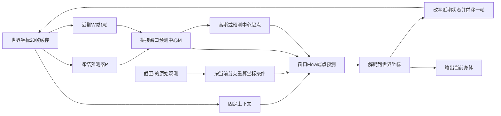

# 滚动窗口重建与成对反馈

2026-11-06。本文对应根目录 [plan.docx](../../plan.docx) 的最新方案，包含公式和两个内嵌 Excel 对照表。代码入口为 [训练](../../run/train_window.py)、[评估](../../run/evaluate_window.py)、[实验矩阵](../../run/window_experiments.py)。旧单帧 G/P 与 `motionstreamer_flow` 保留为历史复现入口。

状态：核心实现、合成数据训练与协议验证完成；真实数据训练和 GPU 精度/延迟实验尚未进行。新增配置中的权重、噪声尺度和默认窗口是可运行的初始设置，并非实验选出的最优参数。

## 窗口、缓存与坐标

每帧仍为归一化的 243 维 `v4_beta` 表示。`WindowCache` 存储 20 帧世界坐标 `BodyState`、模型启动阶段估计的固定体型、启动参考坐标，以及最后提交的物理帧编号。内部沿用源缓存的地面归零世界坐标；数据记录必须提供已减去的 `floor_height`。保存预测时同时输出 `joints_floor_world` 与恢复原始世界高度的 `joints_world`，并保存还原变换，不把地面归零坐标冒充原始世界坐标。

在时刻 t，缓存是 t−20…t−1；W 帧活动窗口是 t−W+1…t；固定上下文是 t−20…t−W，共 21−W 帧。预测器 P 始终读取完整 20 帧历史，而不是只读取固定上下文。各组都读取 t−20…t 的 21 帧原始图像和头部观测，W 改变时观测范围不变。



模型内的所有身体参考增量均相对于同一个公共参考：最近一次缓存身体的平面 heading/xy 参考。历史关节保留原有局部 9D 表示，内部参考增量由原来的相邻帧增量重新编码为相对这个公共参考的增量；每个活动帧均可独立解码到同一世界坐标。原始头部观测也按该分支的公共参考重新编码。P 保留其原先训练使用的相邻增量接口，并将预测先解码到世界，再编码进窗口。

在线输入只接受 `ObservationWindow`，其中包含 21 帧原始头部位姿、1024 维图像特征、两个有效性掩码及窗口末帧编号。输入缺失时先屏蔽无效载荷，再进行几何运算和线性投影。观测编号必须恰好是缓存末帧加一。

每轮更新将固定上下文与重建窗口拼接、移除最早一帧。改写仅作用于内部缓存；此前发出的公共输出不再更改。`revise_recent=false` 对照仅追加当前身体，近期旧状态保持原值。`body_feedback=false` 对照屏蔽全部身体上下文和预测中心，使用固定启动参考及高斯起点，仍读取完整 21 帧原始观测。

## 预测中心 Flow

中心 M 由近期 W−1 个缓存身体和 P 的当前身体拼接组成。两个起点共用同一个冻结 P、显式中心条件和标准噪声 ε：

- 高斯：S = σε。
- 预测中心：S = M + σε。

采用现有 x0 端点参数化，训练路径为 xτ = (1−τ)X* + τS，τ∈(0,1]。基础损失监督完整活动窗口；沿用 E7 对参考 9D 通道的 8 倍权重。默认 10% 的训练样本位于 τ=1，其余为 [0.001,1) 均匀抽样；两组使用相同比例。

Euler 从 τ=1 积分到 0，第 i 次更新为 x ← x + (x0(x,τ)−x)/(K−i)。因此一步求解严格等于网络在实际起点 S、τ=1 处的端点输出；两步、四步及十步保留完整梯度，不调用旧的 `no_grad` 采样接口。

`WindowUniEgoMotion` 默认保留 E7 主干及原历史扩展的参数名，可通过 `load_e7_weights(..., weight_source='ema')` 初始化。窗口参考语义和条件组织已经改变，加载 E7 是初始化，不代表与旧单帧模型数值等价。`--compact` 采用相同前向路径与较小网络，只允许配合显式合成数据诊断。

## 成对反馈及梯度边界

1. 当前可训练 G 完成实际起点的窗口求解，得到当前身体 X̂ 和已修正的近期过去。
2. 两份后续缓存共享本轮修正过的过去部分，并对共同部分停止梯度。
3. 预测分支在 t 写入 X̂，保留输入梯度；参考分支仅在 t 写入一次 X*，停止梯度。
4. 两条分支读取相同的 t+1 原始观测、标准噪声、固定启动体型和求解设置，分别重算完整历史编码、P、中心、公共参考和观测条件。
5. 冻结后续模型求解后，将双方当前身体以同一个 `FixedShapeFK` 解码为同体型、同世界坐标的 SMPL22 位置，最小化预测响应与停止梯度的参考响应之间的距离。

`HistoryPrior.freeze()` 冻结参数并锁定 eval 模式，同时保留对输入的梯度。调用方需要无梯度推理时，使用外部 `torch.no_grad()`；冻结参数本身不应截断完整后续映射。

首轮的后续模型使用初始化 EMA 的**固定快照**，训练过程中不更新该快照。成对/直接后续监督的比较使用相同预热 checkpoint，因此后续模型在整个比较中一致。另维护一份移动 EMA 专门用于开发集选模，两者分别保存在 `feedback_model` 和 `ema` 中。P、后续快照和 SMPL 参数均不接收参数梯度。

总目标为基础窗口 Flow 损失 + λcur 当前身体监督 + λfb 后续反馈。几何项使用关节平方欧氏误差的样本/关节均值，并除以 `scale_m²`；这与文档中向量平方范数相差一个固定归一化系数，由辅助权重吸收。后续噪声多次采样取平均。

支持五种 `feedback` 设置：`none`、`paired`、`direct`、`feature`、`geometry`。`direct` 用预测分支后续输出与下一帧同体型真值比较；其后续模型、输入梯度和求解设置与 `paired` 相同。`feature` 是当前归一化 243 维误差，`geometry` 是固定几何误差，用于检验完整响应度量相对固定度量的额外价值。

## 四组实验与公平对照

`python -m run.window_experiments --window 3 --output exp/window_plan/configs` 输出矩阵和每个组的 JSON，不自动启动训练。窗口 3 只是初始示例，实验一完成后应先在开发集选择窗口，再重新生成后续矩阵。

| 实验 | 实现的比较 |
|---|---|
| 一：在线窗口 | W=1/3/5/10，高斯起点、仅基础 Flow 损失；同窗口固定近期状态对照；同观测范围无身体反馈对照 |
| 二：预测中心 | 高斯与预测中心，共享 P 与显式中心，匹配初始化/尺度/训练预算/端点比例；同缓存单次重建与自身缓存连续重建；评估 1/2/4/10 步 |
| 三：反馈 | 当前监督基线、成对反馈、直接后续真值监督；补充固定特征与几何对照；后续 1/2/4/10 帧诊断及独立连续运行 |
| 四：组合 | A 高斯/无反馈，B 预测中心/无反馈，C 高斯/成对反馈，D 预测中心/成对反馈；复用 A/B/C，只补 D |

为保证续训预算一致，矩阵显式区分 `warmup/*` 与正式比较：

- `source/gaussian`、`feedback/paired`、`feedback/direct` 和固定度量对照都从 `warmup/gaussian` 的相同 EMA 开始，用相同预算继续训练。`feedback/base` 复用 `source/gaussian`。
- `source/prediction` 与 `combination/D` 都从 `warmup/prediction` 的相同 EMA 开始，用相同预算继续训练。
- A/B/C 是对应结果的引用，不能再次训练并重复累计预算。
- 所有组按相同种子、take 划分、模型结构、启动缓存、体型、标准噪声规则及原始观测区间运行。配置生成器给出种子 62/63/64，启动命令需逐个传入。
- 训练噪声按 episode/step/sample/draw 独立确定，先生成十个槽位再切取窗口；改变 W 或反馈 draw 数不改变训练样本、插值时间的随机序列，各窗口的当前帧噪声也一致。

训练默认从已有因果 E7 预测缓存构造初始历史，再进行最多 4 帧当前 G 的无梯度 roll-in，之后做当前与后续训练。该长度会写入实验身份，可用 `--rollin-frames` 统一修改。训练从不把 GT 身体写入常规历史；仅配对参考分支在指定当前时刻写入一次标签。源起点的隔离诊断使用相同缓存，独立连续评估从模型生成的前 20 帧启动，之后全程由各模型推进。

组合交互项为 (A−D)−(A−B)−(A−C) = B+C−A−D；正值表示超过独立收益之和。`interaction()` 返回该项及其他差值。判断稳定性时应先按相同种子、take 配对，再汇总种子间变化。

## 运行

使用仓库的 `environment.yml` / `requirements.txt` 安装环境。真实训练需要已发布的 paired cache、与缓存 manifest 匹配的校准 P、原始 E7 EMA，以及自行授权下载的 SMPL-X；资产恢复方式见 [迁移说明](../release/migration.md)。本次迁移仅获取代码与仓库内文档，没有自动下载大规模数据/权重。

```bash
# CPU 集成检查：合成数据，非真实精度验证
python -m run.train_window --config config/window/paired.json \
  --synthetic --compact --output exp/window_smoke/v1 \
  --train-steps 2 --batch-size 1 --eval-every 1
python -m run.evaluate_window --checkpoint exp/window_smoke/v1/best.pt \
  --synthetic --output exp/window_smoke/evaluation --steps 1 2 4 10

# 生成全部对照配置及初始化/复用关系
python -m run.window_experiments --window 3 --output exp/window_plan/configs

# 真实数据：先训练共同的高斯基础模型；DATA_ROOT 指 paired cache 的根目录
python -m run.train_window --config exp/window_plan/configs/warmup/gaussian.json \
  --data-root "$DATA_ROOT" --prior-checkpoint "$CALIBRATED_P" \
  --e7-checkpoint "$E7_CHECKPOINT" --device cuda --seed 62 \
  --output exp/window_plan/seed62/warmup-gaussian

# 基线/成对/直接反馈分别从同一预热模型继续训练，保持预算相同
python -m run.train_window --config exp/window_plan/configs/feedback/paired.json \
  --data-root "$DATA_ROOT" --prior-checkpoint "$CALIBRATED_P" \
  --initialize exp/window_plan/seed62/warmup-gaussian/best.pt \
  --device cuda --seed 62 --output exp/window_plan/seed62/paired

# 默认仅评估 dev；独立 test 必须显式指定 --split test
python -m run.evaluate_window --checkpoint exp/window_plan/seed62/paired/best.pt \
  --data-root "$DATA_ROOT" --prior-checkpoint "$CALIBRATED_P" \
  --device cuda --output exp/window_plan/seed62/evaluation --steps 1 2 4 10
```

训练输出 `identity.json`、完整的 `resume.pt`、开发集选出的 `best.pt`、`selection.json`、`dev.json`。`--resume` 恢复模型、固定后续快照、移动 EMA、优化器、采样/CPU/CUDA 随机状态；需使用相同参数、代码、资产和输出路径。`--stop-after N` 保存后提前退出当前会话，便于验证或分段运行，不改变总训练预算。初始化续训与精确恢复是两种独立操作。

实验身份锁定 manifest、校准 P、SMPL-X、初始化权重、核心代码、协议及预算；数据加载检查每个 episode 的 marker、SHA256、take 划分和训练统计。时间由原始 30Hz 帧号、stride=3 推导并验证，当前数据为 10Hz：后续 1/2/4/10 帧对应 0.1/0.2/0.4/1 秒。配对多步诊断仅在初始时刻注入一次标签，此后两条分支都使用各自缓存和不断到达的新观测。

评估同时报告 `body_mm`（预测 SMPL22 对数据集世界坐标 GT）、`same_shape_mm`（预测与真值都用启动固定体型解码）、预测中心误差以及实测延迟；先按 episode 汇总，再对 take 等权。延迟含 P、坐标编码、求解、缓存更新及 FK，排除磁盘加载和噪声生成；CUDA 在计时边界同步，首帧单列，其余帧用于平均延迟。输出在 `report.json`，预测序列按需用 `--save-predictions` 保存。

合成模式显式标记 `synthetic=true` 和 `dense_diagnostic`，使用 dense 位置代替持授权资产的 FK，不可用于论文精度结论。当前主机没有真实缓存、模型权重或 SMPL-X，尚不能据此声称窗口、预测中心或成对反馈已带来真实精度收益。

## 验证命令

```bash
PYTEST_DISABLE_PLUGIN_AUTOLOAD=1 python -m pytest tests data_pipeline/tests -q
PYTEST_DISABLE_PLUGIN_AUTOLOAD=1 python -m pytest motionstreamer_flow/tests -q
```

两套测试中存在同名的历史测试模块，需分开运行。新增测试直接验证缓存/坐标、因果范围、噪声配对、各类损失的实际反传、共同过去的停止梯度、冻结 P 的输入梯度、无身体反馈的独立性、数据完整性，以及中断续训与连续训练的逐张量一致性。
