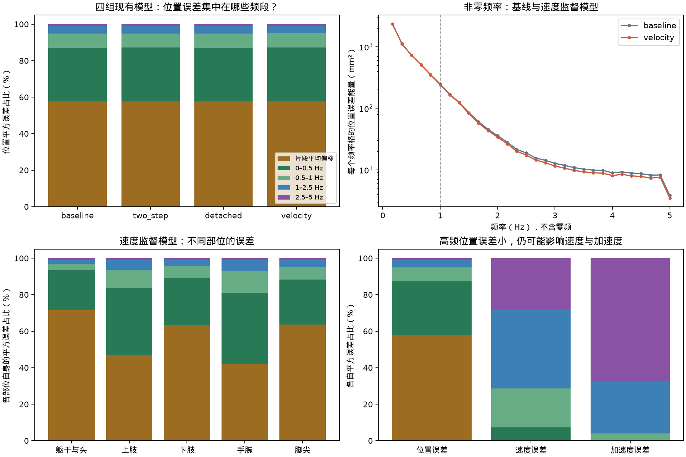
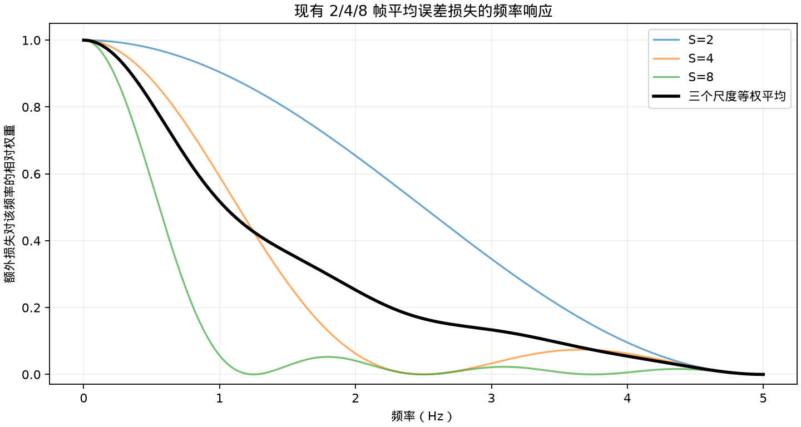

# FFT 误差诊断与低频监督研究备忘

记录日期：2026 年 11 月 11 日。

2026-11-12更新：原A/B对照已完成，A的MPJPE为86.468mm，加入多尺度项的B为86.490mm，速度、加速度和脚滑更差；当前没有该训练项改善指标的证据。正式主线已加入FFT分支TODO：新12k G完成后先重做频谱诊断，首轮P/U对照后独立验证低频监督，两者各自有效后再组合。详见[正式计划第15节](formal_experiment_plan_20261112.md)。下文旧模型频谱保留为历史证据。

现有 EE4D 验证误差主要集中在片段平均偏移和缓慢变化的误差。保留的研究方向是：在逐帧几何、真实运动速度监督之外，额外约束持续位置偏差；先验证已实现的多尺度时域损失，再决定是否引入显式频域加权。

本次记录保留诊断结果和候选设计。FFT 加权训练损失尚未接入，现有训练队列和参数保持原配置。

## 已有验证证据

分析对象为四组已完成的 W=3、高斯起点、冻结学习型 P 的逐帧滚动输出：原始 C、连续两步模型、两步间停止梯度模型、带速度损失的连续两步模型。最后一组的 MPJPE 为 92.046 mm。

四组共用固定 400 个片段、212 个 take；每段输入 80 帧，前 20 帧启动，评分第 20 至 79 帧。运动采样率为 10 Hz，每段评分 60 帧，FFT 频率间隔约为 0.167 Hz。每段、每个关节分别分析三维预测误差，不拼接不同片段。

以下为速度监督模型的位置平方误差能量分布：

| 频段 | 占比 |
| --- | ---: |
| 零频 DC | 57.75% |
| 0 至 0.5 Hz，不含零频 | 29.58% |
| 0.5 至 1 Hz，不含 0.5 Hz | 7.72% |
| 1 至 2.5 Hz，不含 1 Hz | 3.99% |
| 2.5 至 5 Hz，不含 2.5 Hz | 0.96% |

零频至 1 Hz 合计占 95.04%。400 个片段中，有 358 个片段在该范围内的能量占比超过 90%。去除每帧关节质心的整体平移后，相对身体构型误差仍有 94.49% 集中在零频至 1 Hz。对每段误差去均值并加 Hann 窗后，剩余非零频率能量仍有 89.08% 在 1 Hz 以下。

与未使用速度损失的连续两步模型相比，速度监督模型的 2.5 至 5 Hz 位置误差能量减少 8.32%，而零频只减少 0.38%，零频变化的 take 簇 bootstrap 95% 区间跨零。MPJPE 减少约 0.230 mm，区间为 [-0.363, -0.110] mm。

高频仍需约束：速度监督模型约 66.97% 的加速度误差能量位于 2.5 Hz 以上。位置、速度、加速度频谱分别使用各自的误差序列计算；速度和加速度来自真实相邻帧差分。

这些占比描述平方误差，不能换算成可消除的 MPJPE 比例。零频表示每个约六秒片段内的平均误差，不能据此认定长期漂移的原因。旧模型的固定体型、观测歧义和模型能力都可能留下持续误差。



## 现有多尺度持续偏差监督

实现位于 [losses.py](../egorecover/losses.py)，函数为 `persistent_error_loss`。对八次连续因果重建实际输出的世界坐标关节位置，计算有符号误差，再对 2、4、8 帧的完整重叠窗口分别求平均、平方，最后按尺度等权平均：

\[
e_{t,j}=\hat p_{t,j}-p^*_{t,j},\qquad
L_{\mathrm{slow}}=
\frac13\sum_{S\in\{2,4,8\}}
\operatorname{平均}_{t,j}
\frac{\left\|\frac1S\sum_{s=0}^{S-1}e_{t+s,j}\right\|^2}{s_p^2},
\quad s_p=0.1\ \mathrm m.
\]

顺序必须是先平均有符号误差，再平方；先平方再平均会失去对共同偏移的选择性。原有逐帧几何损失继续约束局部错误，速度损失继续对齐真实运动。

已完成的 A/B 对照均采用体型参与最终 FK、官方真实关节几何、连续八次调用和速度监督。A 的 `slow_weight=0`，B 的 `slow_weight=0.03`；两组 `current_weight=0.03`。连续八次调用与每次调用的 W=3 是两个独立设置。A/B的MPJPE分别为86.468/86.490mm，完整结果位于`exp/shape-persistent-W3-20261111/evaluation400/comparison.json`；频谱主要集中在低频，并不保证这份短窗口多尺度损失能降低误差。

只比较几何与持续偏差两项，采用理想滑动平均的频率响应估算，加入该项后，对 0、0.5、1、2.5、5 Hz 误差的相对权重约为 2.00、1.81、1.52、1.17、1.00 倍。有限八帧片段的边界效应和模型参数映射会影响实际梯度。



## 保留的显式频域损失方案

对于完整频谱的正交归一化 FFT，Parseval 等式给出：

\[
\sum_t\|e_t\|^2=\sum_k\|\mathcal F(e)_k\|^2.
\]

因此，所有频率等权的 FFT 平方误差只是普通时域平方误差的另一种表示。新增同类损失只会改变总体权重。

候选改造是分开调整平均偏移与非零低频的权重，以下公式省略 batch 和关节平均：

\[
L_{\mathrm{extra}}=
\frac{\lambda_{\mathrm{bias}}}{s_p^2}\|\bar e\|^2
+\frac{\lambda_{\mathrm{low}}}{T s_p^2}
\sum_{0<|f_k|\le1\mathrm{Hz}}\|\mathcal F(e)_k\|^2.
\]

这里沿时间轴变换预测与真值之差，保留完整复数差。若用 rFFT，应补上成对频率的能量权重。仅比较频谱幅值会丢失相位信息，无法充分约束动作在时间上的对齐。

FreDF 使用复数频率系数之差的模长之和，即频域 L1，并与时域平方误差组合；它不等同于专门加重低频惩罚。其预测任务中的理论条件不能直接套用到短窗口在线身体重建。[FreDF 原文](https://arxiv.org/html/2402.02399)；[FFT 定义与归一化](https://numpy.org/doc/stable/reference/routines.fft.html)；[Parseval 等式](https://www.dsprelated.com/freebooks/mdft/Rayleigh_Energy_Theorem_Parseval_s.html)。

## 后续验证顺序

1. 当前12k G完成后，在相同400片段及连续区间重新诊断误差频谱，检查预测体型FK与官方关节目标下是否仍有显著持续偏差；该诊断无需训练。
2. 首轮P/U对照后，根据新诊断独立冻结低频监督协议。原K8多尺度权重0.03已无改善证据，不直接重复同一设置。
3. 显式约束非零低于1Hz误差需要更长的连续监督。10Hz下K8的FFT间隔为1.25Hz，没有该范围内的非零频点；16/32帧对应0.625/0.3125Hz。补充相应训练与恢复实现，为基础损失和各个新增损失使用相同长度、监督帧预算与更新数，记录计算成本。
4. 独立比较基础损失、只增加普通几何监督、额外均值偏差项、均值加非零低频项，并检查实际加权损失和梯度尺度。当前旧模型2、4、8帧池化误差能量分别约为原误差的98.08%、93.89%、86.14%，三者平均约92.70%，两类目标可能高度相关。
5. U与低频监督各自有效后，才比较共同基线、仅U、仅低频监督与两者组合。P/U未被保留时，低频监督仍可在G＋CV上单独验证；当前训练与首轮P/U目标保持原设置。

主要成功条件是 MPJPE 和目标频段的绝对误差下降，并保持速度、加速度和脚滑指标。只观察频段占比下降不足以证明改善。固定 400 片段用于开发诊断，最终改进需在更完整的验证范围和重复训练中确认。

## 数据与复现

- [完整诊断 JSON](reports/data/fft_error_spectrum_20261111.json)保存四组频谱、身体部位分解、窗口敏感性、take 簇置信区间和来源身份。
- 分析脚本为 [analyze_error_spectrum.py](../scripts/analyze_error_spectrum.py)，只读取已有预测与官方真值，使用 CPU。
- 2026-11-12发布复现脚本时仅整理格式，Python AST与生成历史结果的版本一致。JSON保留原protocol.script_sha256，并在verification.reproduction_script_review分别记录原分析脚本和发布脚本哈希；本次未重算或修改历史指标。
- 本地逐片段结果位于 `exp/error-spectrum-20261111/per_clip.csv`；逐帧预测和模型权重沿用原实验目录。
- 全部 1600 份预测的片段标识与时间戳已核对；已通过零频、已知频率、奇偶长度 Parseval 检查，并与原有粗频段统计一致。

在项目根目录复现：

```bash
conda run -n egorecover python scripts/analyze_error_spectrum.py
```
