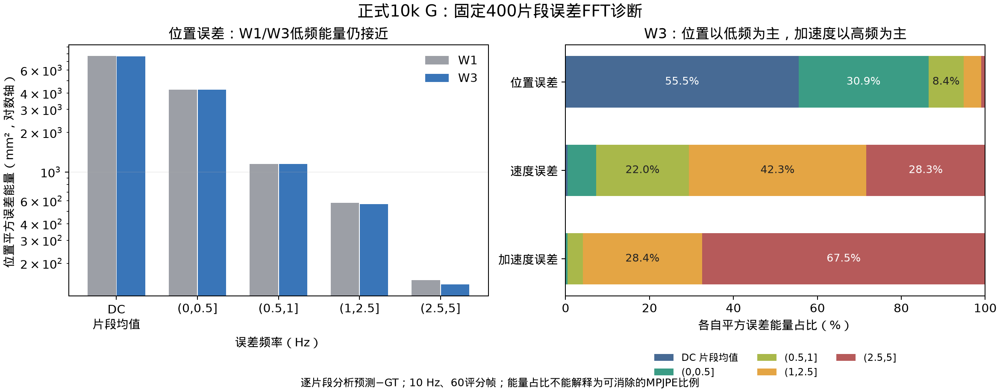
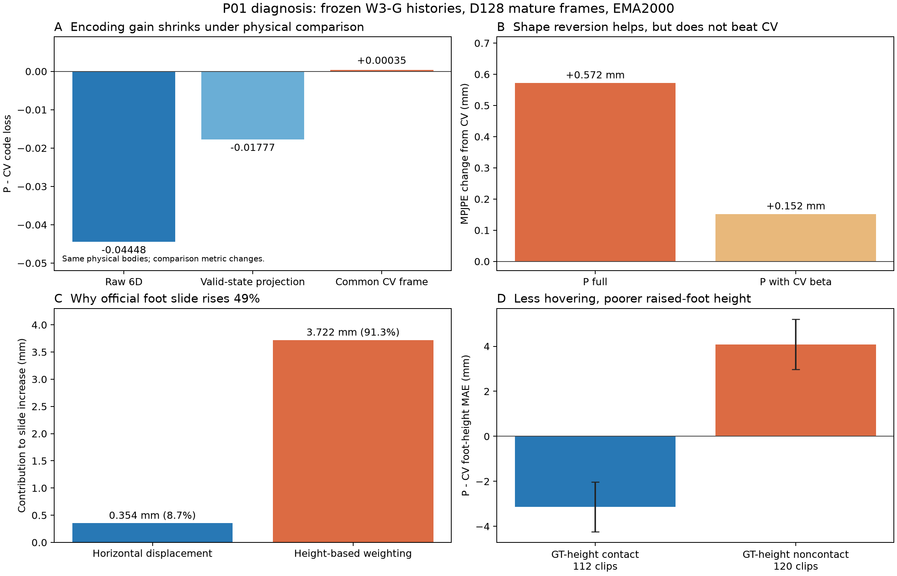

# EE4D 正式实验主线与预算修订记录

**G的v3预算已完成：总计10000步，第1至8000次更新使用3e-5，第8001至10000次使用3e-6，W1/W3各4卡。** 两组保留完整训练状态完成了第8000步后的迁移与续训；原v2的12k调度在交接前取消，未自动延长。本轮用于预算受限的窗口筛选，G训练充分性尚未确认。具体执行与监控见第16节及[10k修订记录](reports/data/formal_budget10k_revision_20261112.json)。下文v1/v2预算与提速记录保留为历史。

**后续TODO顺序已确认：完成G → 训练P → G/P适配与新融合诊断 → 冻结P/G训练U。** 本轮10k G与固定评测已完成并复核，按预定规则推荐W3；P01已完成4卡2000步，但成熟MPJPE和脚滑未达续训门槛，已停止，没有续至10000步。任务顺序见第14节，G结果分析见第17节，最新P训练计划与结果见第18节。第18节取代第6节的旧P草案。

**FFT方向同步保留：新G的400片段频谱诊断已完成，首轮P/U对照后单独验证低频持续偏差监督；两条分支各自有效后再组合。** 诊断结果见第17节，监督实验安排见第15节。

制定日期：2026-11-12，北京时间。用户已授权启动阶段一；运行入口为`exp/formal-v1-20261112/plan.json`，实际预检、训练步数和结果以该目录的`status.json`及检查记录为准。参数预算是本项目的工程选择，不能称为已验证最优。

本计划取代旧实验目录里的临时推进安排。旧实验作为探索记录保留，正式实验不从它们继承 G 或 P 的训练权重。新一轮训练分阶段推进；每阶段只回答一个问题，未通过验收则先分析，不自动增加新分支。

配套文件：[结构化计划](reports/data/formal_mainline_plan_20261112.json)、[新开发128片段](reports/data/formal_dev128_20261112.json)、[清理记录](reports/data/storage_cleanup_20261112.json)。

## 1. 清理与资产保留

已将65个旧检查点路径对应的61个独立文件归档并从项目盘移除，释放49.81 GiB。每个文件在数据盘落盘、SHA256复核后才移除源路径。项目盘可用空间由5.36增至55.17 GiB；数值为清理完成时快照。

归档根目录为 `/gaozt-test1/datasets/EgoRecover-archives/cleanup-20261112-113429`，内部保留原有 `exp/...` 相对路径和 `manifest.json`。需要旧恢复状态时，可按清单将指定文件复制回项目原路径。检查点不受 Git 版本控制，恢复应使用此归档，而不是 GitHub。

项目内保留3份独立恢复状态，合计约3.43 GiB：

- `exp/shape-persistent-W3-20261111/A_shape_real/resume.pt`。
- `exp/ac-detach-velocity-C-20261110/C_two_step_velocity/resume.pt`。
- `exp/prior-two-forward-20261109/training/resume.pt`，其12000步目录另有一个不额外占空间的硬链接。

主实验的best/final推理权重、现用P、共同G父检查点、日志、曲线、评测输出、源码快照和官方数据继续保留。移除的大文件包括旧优化器状态、预检权重和新P两种起点G的2000/6000步中间权重；重要主结果权重未移除。旧大`.pt`中还包含历史缓存，不能全部称为模型权重。

新主线继续使用项目内 `exp/formal-v1-20261112/` 作为输出入口。每组只保留最新resume、best EMA、final EMA及两个规定的中期EMA。阶段完成且不再续训后，再将resume转入数据盘归档。开训前可用空间要求至少20 GiB，运行中保留10 GiB余量；不足时先处理归档，不自动删除主结果。

## 2. 哪些已有结果影响本次决策

11月12日完成的旧模型适配试验，在固定400片段上：

| 设置 | MPJPE mm | 速度 mm/s | 加速度 mm/s² | 脚滑 mm |
| --- | --- | --- | --- | --- |
| A：预测体型FK、官方关节目标、K8 | 86.468 | 195.273 | 2376.642 | 4.011 |
| B：A加多尺度持续偏差 | 86.490 | 199.426 | 2458.474 | 4.231 |

B-A的MPJPE变化为+0.022 mm，95%区间[-0.115,0.156]；时序指标更差。因此新基线采用A的几何、历史与连续训练配方，**不默认加入多尺度损失**。A与旧92.046 mm版本同时存在多项设置和预算差异，其5.579 mm改善不全部归于体型。

W3尚未在最新配方下与W1公平比较；先重建这一对照。预测中心、成对监督、Two Forward P和学习门控均不作为基础训练默认项。

## 3. 全阶段固定协议

| 项目 | v1安排 |
| --- | --- |
| 数据 | 作者官方EE4D-Motion processed；完整官方train用于训练，val用于开发与报告 |
| 数据位置 | `/gaozt-test1/datasets/EE4D-Motion/ee4d_motion_uniegomotion` |
| 输入 | 因果头部轨迹与官方DINO CLS；5 Hz特征因果保持到10 Hz |
| 身体历史 | 20帧，头部中性启动，随后使用自身预测历史 |
| 输出/几何 | 243维接口保留；预测体型参与最终FK；官方拟合身体22关节为几何标签 |
| 内部缓存 | 固定现有dense状态协议；本轮不切换FK投影回写 |
| 起点/求解 | 高斯，sigma=1，NFE=1，endpoint probability=0.1 |
| G基础损失 | Flow + 0.03当前几何 + 0.013409926806430328速度误差；slow=0，paired=0 |
| 历史训练 | 75% roll-in20；25% roll-in0/1/4；活动窗口内部回写开启 |
| 连续调用 | K=8，调用之间缓存停止梯度；各输出保留本步参数梯度 |
| G batch | 全局16个锚点，微批2；每次更新直接监督128个身体 |
| 优化器 | AdamW，weight decay=0.01，betas=(0.9,0.999)，eps=1e-8，clip=1，EMA=0.999 |
| G网络 | width768、12层、12头、dropout0.1 |
| 主种子 | 62；最终核心对照另用162、262复核 |
| 手部 | 保留原PCA监督及辅助指标；本轮不新增手指几何损失 |

W是每次调用的活动窗口，K是训练中连续推进的调用次数。W3/K8表示连续推进8次，每次处理过去2帧与当前帧；不是一次输出8帧，也不是读取未来观测。

0.03和速度系数沿用可用配方，不再同时扫多个权重。如果正式预检发现损失或梯度不稳定，应在开训前修订协议版本，重新冻结；不可在同一实验中途修改后仍沿用原编号。

优化器和网络规模参考[UniEgoMotion Appendix F](https://chaitanya100100.github.io/UniEgoMotion/Patel2025UniEgoMotion.pdf)。本项目在线更新和上游80帧序列任务的监督量不同，batch与epoch不宣称等价；新预算和学习率日程明确按本项目更新次数制定。

## 4. 评测分层与选模

### 4.1 固定集合

- **D128-v1**：从原固定400中按take均衡确定128个完整80帧片段，每1000步验证，用于best EMA选择。它与旧原生128不是同一集合，旧曲线不能接到新曲线前面。
- **D400**：原400不变，SHA256为`07c11f0bb0d7393e8384d5b427682cd88ba754142a2023298e66e7c71b5720b9`。只在阶段结束验收，不每轮选权重。
- **连续滚动诊断**：预检阶段按固定种子从有连续标注的验证take中选50个，记录源区间长度和排除项。每个连续标注区间仅启动一次，不拼接空缺；清单必须在比较前冻结。该清单目前尚未生成。
- **完整官方val**：4379可用片段，用于最终基线和最终方法报告；不为每个无效分支重复运行。

主聚合统一为片段等权，take等权作为补充。位置、速度、加速度、脚滑都从首次公共输出计算，历史回写不能替换已评分输出。片段前20帧启动、后60帧评分；完整val短尾按实际mask记录。

D128、D400都属于已用于开发的官方val，不称独立test。保留完整官方train，避免此时为建立新划分再改变训练数据。完整val过去也被查看过，不追称为未接触留出集。

### 4.2 指标

主精度为世界坐标SMPL22 MPJPE。固定报告PA-MPJPE、速度/加速度误差、脚滑、手腕、头部、体型相关诊断、手指辅助误差和根轨迹。脚部指标还记录有效地面覆盖、足部高度/穿透/离地，防止单看脚滑。

Time在同设备独占计时，包含P/G/缓存/FK，明确排除或另测视觉编码与SLAM，报告均值、P95、NFE及启动成本。并行质量评测耗时不当作每帧延迟。

UniEgoMotion论文完整80帧、EgoForce输入手腕控制等差异仍须披露。当前60帧在线协议不能直接等同论文原表；仅引用发表指标时应标明“论文报告值、协议不同”。详见[外部比较协议](comparison.md)。

## 5. 阶段一：随机初始化基础G与窗口选择

只运行两组：`V1_G_CV_W1_s62`和`V1_G_CV_W3_s62`，各4卡。两组相同随机初始权重、相同物理查询及当前槽噪声，唯一设计因素是W。噪声按片段、查询时刻和物理槽位派生，W3额外两个过去槽有各自的固定键；不能将不同形状的随机张量都设同一个seed便称为同噪声。P使用CV，不加载旧学习P，也不继承旧G。

两组均训练**32000次更新**：

| 更新范围 | 学习率 |
| --- | --- |
| 1..12000 | 3e-5 |
| 12001..24000 | 9e-6 |
| 24001..32000 | 2.7e-6 |

该StepLR日程可由现有G训练器显式decay_step=12000、gamma=0.3表达，替代默认过晚的衰减点。每组总计4096000个直接监督身体，但相邻身体相关，不能称为同等数量独立样本。

2000步只作健康检查，不因为一次排名换损失或换架构。全程相同评测次数，best EMA仅按D128-v1世界MPJPE选取；同时报告final EMA，不能用D400另挑某个检查点。

**可冻结用于下一阶段的条件**：有限数值、训练/验证曲线可解释；经历低学习率阶段；最后4000步内D128最好MPJPE改善不足0.5 mm；连续滚动没有异常发散。这是工程平台判据，不是全局收敛证明。若任一窗口仍持续改善，两组共同续训8000步，最多40000步，保持优化器与调度器状态。达到上限仍不满足则记录“训练充分性未确认”，先分析，不无限续训。

**窗口选择**：完成同预算D400评测。位置差超过1 mm时选择较低MPJPE；差不超过1 mm时，若一组在速度、加速度、脚滑中至少两项更好，另一项恶化不超过5%，优先该组；否则选择较低MPJPE。同时报告take簇bootstrap区间和连续滚动结果。出现明显长滚动异常时暂不锁窗，先检查。规则提前固定，不根据结果改权衡。

## 6. 阶段二：新历史上的P

**历史草案，已由第18节取代。** 以下W1/W3混合、GT热身和18k预算没有执行，不作为下一轮P训练配置。

固定阶段一W1/W3两份G，按相同物理片段生成各自历史库。训练库仅来自train，验证库仅来自D128-v1；最终D400验收历史另建。覆盖尽可能多的合格训练take，公布覆盖率，不能再静默截取1024片段后当作全分布。

训练历史采样同时覆盖启动和成熟；W1/W3生产者1:1，G历史中成熟/启动75:25。P读取历史，不读取当前或未来GT、图像或头部条件。

`V1_P_s62`从随机初始化训练，4卡，batch64、micro8，网络256宽/4层/8头/dropout0.1。安排为：

- 1..2000步：GT历史热身。
- 2001..18000步：80%冻结G预测历史、20%GT历史。
- P自历史替换比例为0，本轮不引入Two Forward。
- 学习率3e-5，每6000步乘0.3，每1000步验证。
- 编码损失加官方关节几何；**P自身也用预测体型FK**。几何系数按固定train-only梯度标定规则确定，seed9062、上限0.03、初始加权几何/编码梯度范数目标0.1；标定结果写入身份后固定，不在val上挑系数。

混合比例按全局累计配额实现，微批只作分片，记录实际GT/G及各生产者样本数，避免每个微批独立取整改变既定配比。

P的预测体型FK、学习率调度及恢复、片段等权评测需先补实现和测试；当前旧P训练器仍是固定零体型和恒定学习率，本计划不声称这些准备已完成。

**P验收**：在同一G产生的同一历史上，分别计算P和CV，不拿两个不同G历史的误差互比。选定窗口的D400预测MPJPE至少降低1 mm且配对95%区间上界小于0；速度、加速度各不恶化超过5%；分列启动、成熟、身体部位和长滚动。低学习率最后4000步改善不足0.5 mm后，才作为当前生产者版本的冻结P。若仍改善，最多追加6000步至24000；未通过则先分析数据分布和误差来源，不自动开新G分支。

从实际运行分布训练的原则可参考[DAgger](https://proceedings.mlr.press/v15/ross11a.html)；此处是分布匹配的工程借鉴，不宣称直接满足其理论假设。

## 7. 阶段三：检验P能否改善最终G

P单独优于CV仍不足够。仅在阶段二通过后，选定W，从同一个阶段一G EMA分叉：

| 组别 | 预测器 | G初始化 | 预算 |
| --- | --- | --- | --- |
| `V1_G_CV_control_s62` | CV | 同一基础G | 追加8000步 |
| `V1_G_P_s62` | 新冻结P | 同一基础G | 追加8000步 |

两组都重建相同的新优化器，lr1e-5、每4000步乘0.3；基础损失、K8、锚点batch、历史课程和高斯起点保持一致。每组新增1024000个直接监督身体。两组都追加训练，避免把“使用P”与“多训练8000步”混为一谈。P自身的训练成本单列，不能称整个系统计算预算相同。

验收仍看D400与连续滚动：最终MPJPE至少降低1 mm、配对区间上界小于0，速度/加速度/脚滑分别恶化不超过5%。未达到则记为“当前版本没有达到预设系统收益门槛”，不是给结果换解释。平台不足时最多给两组共同追加4000步，不单独续训某一组。

验收时还在这两组G各自产生的历史上重新做匹配P/CV诊断，检查历史分布漂移。生产者版本、P版本、G版本均锁定；若需要刷新P，应另立P02及新对照，不能覆盖P01或偷偷更换。

## 8. 阶段四：基础通过后，只开放一个创新方向

此阶段不预排训练。优先候选为P先验与G候选之间的因果校正门控，但先用**新P/G**重新做融合空间诊断；旧模型“约7 mm GT门控收益”不能搬到新模型上。

若新诊断支持继续，再比较同一P/G下的G直接输出、训练集拟合的常数融合、因果可学习门控。所有组使用实际融合反馈后的历史滚动评测，不能只对旧G输出离线拼接。门控k=1必须精确复现原G状态更新；若需要FK投影回写，必须补共享投影的对照，不能同时改变缓存表示后归因于门控。

预测中心和成对监督若仍作为论文贡献，应在新基础上做各自单因素对照。多尺度的权重0.03已无当前收益证据；如重开，必须有新机制依据并包含普通几何增权对照。以上分支不同时启动，也不预先承诺全部做。

## 9. 编号、复核与论文报告

每次运行登记run_id、唯一变量、父G/P文件SHA、初始化方式、是否重置优化器、数据与历史生产者、代码快照、seed、GPU、更新数、锚点数、直接监督帧数、损失、学习率、评测清单及选模结果。完成后冻结记录；改配方使用新版本。

共享初始化和匹配查询的对照，开跑后核对初始权重、查询/当前槽噪声清单并记录首次损失。只有设计差异不影响某损失分量时才要求该分量相同；不同W或不同P条件不要求首次Flow损失相同。P冻结时核对训练前后SHA一致。保留train曲线、D128曲线、best/final、D400逐片段数据与验收结论。

主种子62完成阶段筛选后，仅对最终基线与最终方法用162、262重复匹配流程，报告3种子均值与标准差，以及固定权重上的take簇区间。P是流水线一部分，其来源与成本必须计入，不仅重复最后一小段G。

正式表格固定协议后再做完整val；原论文报告值仅作明确标注的参考。若原设想仍未通过受控实验，应按证据调整论文方法定位，不把基础训练收益改名为创新收益。

## 10. 下一次实施的具体边界

阶段一已接入固定D128并核对官方物理片段；现有按查询键生成10槽再切片的噪声已共享当前槽，无需另换随机机制。模型训练代码已冻结。真实四卡预检已比较连续两步与中断恢复两步，并跨一次学习率下降：采样、CPU/CUDA随机状态、学习率、优化器步数与固定教师严格一致；GPU权重在float32数值精度下吻合，最大差约1.49e-8，未达到逐位一致。CPU精确恢复另有全套测试覆盖。

GPU预检最初使用逐位相等而被拦截，复核后仅修订了检查器的数值精度判据，没有修改训练目标、学习率、窗口或随机种子。两步未训练模型的滚动验证差异已单独记录，不能称为验证输出逐位复现。详细边界见`exp/formal-v1-20261112/preflight-verification.json`及[PyTorch复现说明](https://docs.pytorch.org/docs/2.10/notes/randomness.html)。

连续滚动清单已固定为50个验证take各一个连续标注区间，输入229至1200帧，上限120秒；它不代表整条take。该诊断在训练及固定400评测后自动进行，不能跨标注空缺拼接。

第一批仅启动W1/W3两组基础G，各4卡。标准预算32000步。原生检查点身份预留40000步上限，首次以`stop_after=32000`截停；控制器依据预先规定的平台规则决定是否两组共同延长8000步，始终保留优化器和调度状态。400和长区间评测使用D128选出的best EMA，另保留final EMA，不根据400重新选检查点。

启动与监控命令如下；二次启动同一控制器会被锁拒绝，不能并发重复启动：

```bash
conda run -n egorecover --no-capture-output python -m scripts.run_formal_mainline monitor \
  --plan /root/workspace/songxuhua/exp/formal-v1-20261112/plan.json
```

P的预测体型FK、调度恢复与历史混合配额在阶段二实施前补齐；阶段一不加载学习P，也不会自动启动后续P训练。旧主结果、数据集与现有环境继续保留。

## 11. 第1000步后的工程提速

2026-11-12两组均从已保存的第1000步断点恢复到`source-runtime2`源码快照。原`source`与清理前断点、身份、训练日志保存在`exp/formal-v1-20261112/runtime-upgrade-20261112/full-fk/`及原目录。停止时尚未落盘的W1第1001至1094步、W3第1001至1065步从断点重算；旧日志保留，活动日志先截到1000步，避免重复步数污染曲线。

本次仅改变运行实现：先对SMPL-X的关节回归器、模板与十个体型基预计算，再仅递推22个身体关节；预测beta仍参与FK并保留梯度，局部旋转及父链组合仍保留。`FixedShapeFK(..., backend="full")`保留完整SMPL-X数值参考。手部PCA的Flow监督不变，需要手部或网格的评测仍调用完整模型。

合并模型与缓存的有限值检查，传感器可用性检查改为掩码归约；所有字段仍被检查，退化旋转检查仍保留。仅在`eval`及roll-in时不再请求未使用的注意力权重，训练时的注意力及dropout随机路径保留。

窗口、K8、历史混合、全局batch16、microbatch2、监督权重、随机种子、学习率与32000/40000步规则不变。断点只更新源码哈希，序列化后逐项比较了其他所有字段，包括模型、EMA、固定教师、优化器、调度器和各卡RNG，均逐位相同。控制器按`resume.pt`的实际步数计算剩余预算，避免误用尚未落盘的`progress.json`。

最终测试412项通过，另有真实资产GPU对照通过。固定第1000步权重、输入、噪声与dropout种子的W1/W3成熟20帧历史K8微批对照中，整体梯度相对L2差异均小于8e-7。该精度验证不承诺后续GPU训练轨迹逐位一致，也不把单卡微批计时当作四卡整步加速。实际时间、检查点SHA、版本与恢复检查见[提速核验记录](reports/data/training_speedup_20261112.json)。

## 12. 第二轮提速：保存第2000步后统一切换

第一轮四卡整步短测仅减少约4%至6%的耗时。因此第二轮转向重复的模型调用和CPU发射开销，继续保持FP32、全局batch16、逻辑microbatch2、K8与原历史混合配额：

- 同卡、同目标帧、同roll-in长度的历史先合批生成，再拆回原来的逻辑microbatch。两组mature20的roll-in调用由40次变为20次；查询、tau、噪声偏移及训练反传顺序不变。
- Flow和当前几何两个前向复用本次调用的确定性prepare/source，避免重复计算。不同物理帧或成对参考分支之间不共享准备结果。
- 仅对`eval`且`no_grad`的12层decoder使用编译与CUDAgraph，训练图仍为eager。输入检查和输出投影位于编译区外，避免历史输出被后续图重放覆盖。编译在恢复与EMA/教师复制之后启用；不得在启用后直接deepcopy已绑定编译函数的模型。

2026-11-12 16:22北京时间的检查结果为：完整测试427项通过；B2/B4的CUDA核验确认读取原位更新的参数、旧输出不被覆盖、state_dict参数键不变。固定第1000步权重与输入的成熟20帧、每卡两个microbatch的诊断中，W1/W3候选实现相对第一轮分别约快1.43倍、1.42倍，整体梯度相对L2差异均小于8e-7。该诊断与正在运行的训练共享GPU，**不是四卡整步计时或最终训练时长保证**。BF16未进入正式训练。

自动切换程序为`scripts/schedule_formal_runtime.py`，准备源码为`exp/formal-v1-20261112/source-runtime3/`，计划为同目录`plan-runtime3.json`。两组均完成第2000步验证及原子保存后，才停止旧进程、归档其源码与状态、逐项核验迁移后的断点，并以原优化器和调度器恢复。剩余预算按已保存的2000步计算。若新版启动失败，恢复原断点及第一轮实现继续训练。

切换和恢复预热后，程序自动记录90秒的四卡整步耗时，写入`exp/formal-v1-20261112/runtime-upgrade-status.json`、`exp/speedup-20261112/production-runtime3.json`及[提速记录](reports/data/training_speedup_20261112.json)。本节记录已准备并排队的实现；实际是否切换以及真实收益以这些运行文件为准。

## 13. v2：12k预算窗口筛选，10k后降低学习率

2026-11-12用户要求压缩32k预算，并明确指定“10000步降到3e-6”。本轮总步数改为12000，包含已训练前缀；两组同时采用以下日程，不重置权重或优化器：

| 更新范围 | 学习率 |
| --- | --- |
| 1..10000 | 3e-5 |
| 10001..12000 | 3e-6 |

衰减发生在第10000次更新完成后，下一次更新使用新学习率；不能将第10000次更新也记为3e-6。衰减点为总进度的83.33%，借鉴后段精调的安排，但不与UniEgoMotion的85.71%或其总训练量宣称等价。总更新数相对原32k减少62.5%，这是资源与训练充分性的取舍，不是已验证的最佳预算。

新案例为`V2_G_CV_W1_12k_s62`与`V2_G_CV_W3_12k_s62`，新入口为`exp/formal-v2-12k-20261112/plan.json`。各自保留原V1随机初始化训练前10000步；W1先到时固定其10k断点，等待W3也完成10k验证和原子保存，再统一迁移。等待期间可能多执行的更新只保留在V1日志，不计入V2进度。

断点迁移逐项检查模型、EMA、固定教师、AdamW动量、各卡采样及CPU/CUDA随机状态、best值和验证曲线。只允许修改总步数、衰减设置与当前学习率；保留调度器计数、初始学习率与base_lrs，不多调用一次scheduler.step。新断点序列化后再次复核。原V1目录、源码、日志、best与恢复权重保留，新目录追加后2000步。历史日志中原来记录的next_learning_rate保持原值，另用budget-revision.json记录新日程，避免篡改历史记录。

原生模型与训练包保持runtime3版本，各4卡、FP32、K8、global batch16、micro2、历史混合、CV、高斯起点、0.03当前几何和速度损失均不变。自动控制器只接收`[12000]`一个预算，原生上限也是12000，不执行32k/40k或任何自动延长，不自动启动P。为保证最终汇总可执行，补齐原计划缺失的formal_paired_helper.py，保持原400片段汇总的片段等权、take簇重采样2000次与seed1062，指标定义不变。

仍每1000步用同一D128验证，按该集合选择best EMA；训练结束自动进行同一D400及50段连续区间评测，同时保留final EMA。12k仅有2000步低学习率阶段，不能满足v1“低学习率末4000步平台”的完整冻结判据。完成后先检查曲线与滚动结果、选择窗口，再单独决定后续训练充分性与P阶段；本次不会自动恢复原长预算。

CPU恢复与编排测试覆盖新旧日程在衰减前的等价性、AdamW动量连续性、精确衰减边界、两组断点独立固定、父目录不被覆盖及12000步后进入固定评测。实际执行阶段以运行状态为准：

```bash
conda run -n egorecover --no-capture-output python -m scripts.run_formal_mainline monitor \
  --plan /root/workspace/songxuhua/exp/formal-v2-12k-20261112/plan.json
```

等待期间显示`waiting_for_parent_checkpoint`与两组实时步数，实际降学习率和新案例恢复要等共同10k断点；迁移明细见该目录的budget-revision-status.json。调度程序为scripts/revise_training_budget.py，采用独占锁避免重复启动。

## 14. 已确认TODO顺序：G → P → G/P适配与诊断 → U

确认日期：2026-11-12，北京时间。本节记录后续顺序与验收依赖；W1/W3的10k训练及固定评测已完成，后续训练尚未排队。第6节旧P草案由第18节取代；第7节G适配预算仍为草案，实施前独立冻结。

- [x] **T1：完成当前G并确定本轮预算下的基础版本。** W1/W3各完成10000步及D400/long50评测，按预定选窗规则推荐W3、10000步best EMA。已核对逐片段汇总、频谱与长段误差；记录“训练充分性未确认”，本项完成不代表最终收敛。检查点、曲线和复核见第17节，未自动延长。
- [ ] **T2：在新G历史上训练并验收P。** W3单生产者、纯G历史的P01已完成适配、预检、正式库和4卡2000步；成熟MPJPE及脚滑未达到续训门槛，已停止，待失败诊断。保留启动/成熟分组及匹配CV结果，不自动开展后续G。P单独误差更低仅是阶段证据，不能代替最终G收益。
- [ ] **T3：G适配新P，随后重做融合诊断。** 从同一T1 G检查点分叉，以相同新增G更新预算、查询、损失和高斯起点，对照CV＋G与学习P＋G，记录P单独训练成本。当前G学习的是CV条件，需要匹配适配后再判断学习P的作用。适配结束，在新P/G、同一输入缓存和噪声下重做整体及分部位融合空间诊断，记录可融合改善、误差相关性与时序变化。旧模型约7 mm的GT门控空间仅是探索证据；GT选门控只用于推理后的诊断，不写回历史，不作为部署结果。
- [ ] **T4：有融合依据后，冻结P/G训练U。** U指借鉴KalmanNet思想设计的因果身体校正门控。首轮只训练U，比较CV＋G直接输出、P＋G直接输出、CV＋U和P＋U；前两组复用T3对照，另保留训练集拟合常量门控参照。首先考虑根、躯干与头、左右臂、左右腿六个部位，具体结构与预算在该阶段冻结。U使用截至当前的可用信息，通过最终输出几何和速度损失学习。显式k=1对照须复现原G完整滚动，不同时改变缓存表示或FK回写；部署评测让融合结果真实回写，在同一D400和连续区间上核对MPJPE、速度、加速度、脚滑及新增耗时。

T3判断学习P直接作为条件是否有帮助，T4中P＋U对CV＋U判断学习P在自适应校正之外是否有独立价值。直接P条件收益不足时，只有新诊断提供了明确互补性依据，才另行记录理由推进U；不能默认所有阶段必然通过。若CV＋U与P＋U表现接近，优先保留成本更低的配置。P和U均需以最终闭环收益决定是否进入最终系统。

各项完成后先复核结果和实验身份，再推进下一项。FFT启发的损失、预测中心起点和成对监督继续保留为独立候选，不与上述首轮U验证同时改变。

## 15. FFT分支TODO：诊断、独立监督对照与组合

FFT方向解决误差在时间上的持续偏移，P/G/U方向解决状态预测与观测校正。两者可以组合，先分别检验收益。旧频谱结果、公式与实现边界保存在[FFT研究备忘](fft_low_frequency_loss_20261111.md)。

- [x] **F0：T1评测完成后，重做新G的误差频谱诊断。** 2026-11-13已用两组800份已保存D400预测完成CPU分析，未重新推理。逐片段核对ID、评分帧、时间戳、官方GT及位置/旋转汇总；新结果见第17节及[分析JSON](reports/data/formal_g_analysis_20261113.json)。两组100份long50预测另作段内误差与全长FFT检查，不拼接独立区间。
- [ ] **F1：新诊断仍显示持续偏差时，冻结一份低频监督协议。** 分开定义片段均值偏差项和非零低频加权项，不把所有频率等权的FFT平方误差当作新约束。保留复数差与时间相位，rFFT正确补齐成对频率权重。频段和权重在训练前固定；旧模型约95%的DC至1Hz能量占比不能直接套到新体型FK基线，也不是可消除的MPJPE比例。
- [ ] **F2：首轮P/U对照固定后，单独进行低频监督消融。** 从选定基础模型的同一检查点分叉，在相同连续监督长度、历史策略、更新数和监督帧预算下，对照基础损失、增加普通几何监督、额外DC项、DC与非零低频项。对齐并记录实际加权损失/梯度尺度及计算成本，区分增加监督强度和选择性约束持续偏差的作用。保留既有多尺度失败结果，不直接重复slow_weight=0.03。若P/U未保留，该分支仍可在G＋CV基线上验证。
- [ ] **F3：低频监督与U分别有效后，再做组合。** 比较共同基线、仅U、仅低频监督、U加低频监督；匹配适配预算，检查效果能否叠加。低频监督优先作用于最终实际提交的身体输出，U的融合结果真实回写历史。

10Hz下，当前K8只有8个监督样本，FFT频率间隔为10/8=1.25Hz，无法直接分辨0至1Hz内的非零频率。研究16或32帧连续监督时，需要补充实现与恢复核验，并给所有损失对照使用相同长度；K8均值偏差约束与低于1Hz的显式频谱监督不能混为一项。频谱诊断可使用完整60帧输出，其频率间隔约0.167Hz。

既有体型/官方关节A/B对照为A=86.468mm、B=86.490mm；加入K8多尺度项未改善MPJPE，速度、加速度和脚滑更差。因此FFT分支当前是有误差诊断依据、尚未验证有效训练方法的研究假设。通过条件是目标频段的绝对误差和MPJPE降低，时序指标保持可接受；只降低频段占比或只改善非闭环输出不算通过。

以上为计划记录，当前10k训练与首轮P/U对照保持原目标。P、G或U的首次有效性检验不同时加入FFT损失。

## 16. v3：8k后降学习率，总计10k

2026-11-12用户明确要求“8000步降学习率，总训练10000步”。实际日程为：第1至8000次更新使用3e-5，第8000次完成后降低学习率，第8001至10000次使用3e-6。两组仍各4卡，并保留2000步低学习率阶段。

与v2相比，减少2000步高学习率训练，总预算减少16.67%。作为本轮窗口筛选，这是资源与精度的取舍；两组6000至7000步D128仍分别改善约0.774和0.683mm，训练充分性尚未确认。10k结束后先检查曲线和滚动结果，再决定后续基础模型用途，不自动续训。

新入口为`exp/formal-v3-10k-20261112/plan.json`，案例为`V3_G_CV_W1_10k_s62`、`V3_G_CV_W3_10k_s62`。它们直接继承仍运行的v1/runtime3各自第8000步断点；v2仅等待10000步，未执行过迁移，其调度程序已取消，计划与记录继续保留。

第8000步的模型、EMA、固定教师、AdamW动量、随机状态、best和验证曲线按第13节相同审计规则保留；只修改总预算、调度边界与当前学习率。原生训练包与非预算设置不变。W1先到时先固定8k断点，等待W3完成8k验证与保存后统一交接；额外执行但未继承的更新仅保留在父日志。

原生上限与控制器预算均为10000，不自动延长或启动P。结束后仍按相同D128规则选best，自动进行原D400和50段连续区间评测；后续P、G适配、U与FFT TODO顺序保持第14、15节安排。

```bash
conda run -n egorecover --no-capture-output python -m scripts.run_formal_mainline monitor \
  --plan /root/workspace/songxuhua/exp/formal-v3-10k-20261112/plan.json
```

等待与迁移状态见该目录budget-revision-status.json；本次调度显式使用`--checkpoint-step 8000`，不沿用旧CLI的10000步默认值。

## 17. 2026-11-13：阶段一结果、瓶颈与新FFT分析

两组10000步训练及两套固定评测于2026-11-12 22:40北京时间全部完成，best EMA均为10000步。D400每组400片段/212takes/24000评分帧；long50每组50连续区间/36858评分帧。CPU诊断重用保存的首次输出，逐项复核数值与汇总一致。完整部位、频谱、训练曲线和长段统计见[分析数据](reports/data/formal_g_analysis_20261113.json)，外部论文数值参考另见[比较协议](comparison.md)。

| 评测 | W1 MPJPE mm | W3 MPJPE mm | W3速度误差下降 | W3加速度误差下降 | W3脚滑下降 |
| --- | ---: | ---: | ---: | ---: | ---: |
| D400 | 88.993 | 88.634 | 4.11% | 6.39% | 13.75% |
| long50 | 97.871 | 97.500 | 3.29% | 6.05% | 9.63% |

按预先固定的“MPJPE差小于1mm时优先时序至少两项更好、其余不过度恶化”规则推荐W3。其主要收益是时序表现，位置改善仅0.359mm；D400该差值95%take簇区间[-0.696,-0.021]mm，long50为[-1.192,0.428]mm。PA-MPJPE在D400/long50分别比W1高0.105/0.349mm。400片段中223段W3位置更好，其余177段未改善，不能概括为每段都改进；当前仅单训练种子。

两组D128每个检查点均改善，末1000步均再改善约0.26mm，末4000步仍改善约1.96至1.98mm；没有整体训练下降而验证持续反弹的迹象，也没有充分收敛证据。10k是本轮选窗预算，供下一阶段使用时应锁定为明确的有限预算生产者版本。

**主要剩余误差位于四肢。** W3头部位置误差27.915mm、手腕147.579mm、脚端151.358mm；下肢8关节占全部位置MSE的53.69%，手腕与脚端四个关节合计占43.02%。正交质心分解中，整体平移项占位置MSE的30.30%，相对身体构型项占69.70%。这些是平方误差份额，不能写成MPJPE的可加分解；其结果提示仅调整整体轨迹不够。

**W3尚未明显降低主要的持续误差。** 对每段60帧、10Hz的预测减GT误差做正交rFFT，正确补齐成对频率权重后：

| 位置误差频段 | W1能量占比 | W3能量占比 | W3相对W1该频段绝对能量减少 |
| --- | ---: | ---: | ---: |
| DC，片段平均误差 | 55.65% | 55.53% | 0.70% |
| (0,0.5]Hz | 30.76% | 30.94% | -0.10% |
| (0.5,1]Hz | 8.32% | 8.39% | -0.37% |
| (1,2.5]Hz | 4.19% | 4.14% | 1.75% |
| (2.5,5]Hz | 1.08% | 1.00% | 7.17% |

W3的DC至1Hz合计94.86%；去掉每帧关节质心平移后，相对身体构型误差仍有94.19%在该范围。去均值加Hann窗的非零频敏感性检查仍有89.25%落在1Hz内。另一方面，W3加速度误差能量的67.46%位于2.5Hz以上。因此高频改善较明显而位置MPJPE改善很小，是与当前误差分布一致的现象；不能据此单独证明具体回写机制的因果贡献。

long50按各连续区间全长分别FFT，频率间隔为0.00847至0.04785Hz，能量先按区间等权平均再算占比。W3位置误差的DC至1Hz仍占92.43%，去除质心平移后为91.00%；DC单独占35.38%，高于2.5Hz占0.99%。这与6秒D400的55.53%DC不能直接对比为性能改善：DC是各自区间长度上的均值。长区间仍呈低频主导，但其加速度误差的64.56%在2.5Hz以上。



**long50不支持平均误差持续增长的简单结论。** W3前/中/后1/3误差为98.010/96.445/98.038mm，后减前0.029mm、95%区间[-6.096,6.374]mm。最初60帧已有95.765mm，比D400平均高约7.13mm；两集合动作构成不同，不能将97.500对88.634的差直接归于漂移。该检查不排除个别动作失配，也不替代同一目标帧的持续滚动/重置干预。

**P与FFT分支的后续解释。** 各模型自身历史上的CV中心误差为W1=100.226mm、W3=95.706mm，经G后分别为88.993/88.634mm；中心端相差4.52mm，输出只差0.36mm。由于历史不同，这不是独立P因果对照，但说明更准确先验不会自动等量传递到最终重建。按既定顺序推进P准备，补齐预测体型FK、调度恢复与新历史数据，最终仍以G闭环增益验收。

FFT诊断支持继续研究持续偏差监督，但旧K8多尺度0.03结果仍为无改善。本轮2/4/8帧池化后的MSE分别保留原值约97.98%/93.54%/85.29%，短尺度与逐帧几何目标可能重叠较多，不能据此断言梯度相同。后续显式低频实验应区分DC和非零低频，在同一更长监督长度下补普通几何增权对照。当前K8的1.25Hz分辨率无法提供1Hz以内的非零频点。P/U与低频监督先独立验证；未启动P、U或新损失训练。

## 18. 2026-11-13：在新W3 G历史上训练P的执行计划

**状态：P01完成2000步，未达续训门槛，已自动停止并保留权重、恢复状态及日志。** 实验编号为`P01_W3G10k_s62`，输出到`/root/workspace/songxuhua/exp/formal-p-w3-g10k-20261113/`，使用conda环境`egorecover`。结构化配置见[新P训练计划](reports/data/formal_p_training_plan_20261113.json)，执行与结果见第18.6、18.7节。

### 18.1 本轮只回答P在真实G历史上能否胜过CV

固定阶段一选出的W3、10000步best EMA作为历史生产者：

- 检查点：`exp/formal-v3-10k-20261112/V3_G_CV_W3_10k_s62/best.pt`。
- SHA256：`4f748009e20193b68efca7cc5e47b28c3613995cac96bcfe4cd397ad01131d67`。
- 原生检查点训练数据身份：`eadd4e5cb98257adf6fcd068ffdf4fdaa78f78e3530b309f8a18a9b23d6b1d42`。历史库必须另登记自身split的数据文件、归一化统计、启动器及划分身份，不能要求val库的split摘要等于训练摘要；也不能以早期预备计划中不同启动配置的摘要代替实际生产者身份。
- 生产过程保持CV条件、高斯起点、NFE1、W3内部回写、现有dense缓存和预测体型FK；登记冻结源码与启动器版本。G不更新，P不反馈到此历史库。

本轮只训练一个W3专用P。W1不是训练生产者或选模门槛，可在结束后作为额外泛化诊断。这里冻结的是一个明确的10k预算G版本，不声称G已经充分收敛；更换G后须重新检查分布匹配。

P输入为截至`t-1`的20帧身体状态和来源标记，预测当前`t`的243维身体编码：

\[
M_t=P(H_{t-20:t-1})=\mathrm{CV}(H_{t-20:t-1})+R_\theta(H_{t-20:t-1}).
\]

沿用256宽、4层、8头、dropout0.1的历史Transformer。主干随机初始化，残差输出头置零，初始输出精确等于CV；因此不再安排GT历史热身。训练100%使用冻结G真实缓存，包含正常头部中性启动阶段；GT只进入标签。P不读当前头部、图像、当前/未来真实身体，本轮不做P自历史替换、Two Forward、U、预测中心切换或FFT损失。

### 18.2 历史库与采样：覆盖来源，单独控制成熟度

官方train元数据共17045条source、2032个take、3037079帧。沿用现有loader至少22帧的要求，合格16760条source、2031个take；285条短source排除，其中一个take无合格source。该统计只是元数据检查，不是重新核验完整数据。

每条合格source固定抽取一个连续上下文，长度`min(160,T)`；长source的起点从`[0,T-context_len]`按固定种子2062派生。先用该上下文最初20帧的头部中性状态启动，再连续调用冻结G。不能在每个训练锚点前重置历史，也不拼接标注空缺。上下文覆盖全体合格source，不意味着遍历了全部3037079帧。

局部调用数`L=0`对应query20，合法上界为`context_len-21`。当前query的P样本必须在本次G更新之前从缓存提取，来源标记反映W3此前真实回写；成熟度按局部L计算，另存`context_start`、source绝对query、timestamp，避免把随机截取起点误当作roll-in。

- 每个上下文最多8个不同锚点：最多3个启动锚点，从合法`L∈{0,1,4,8,12,19}`确定性抽取；最多5个成熟锚点，在合法`L≥20`范围内均匀布点并去重，包含该范围端点。短上下文按实际合法数量保留，不复制凑数。
- 成熟定义为至少20次真实G调用，即局部query≥40；启动为query20..39。W3回写可能更早填满20个预测槽，但不据此提前改变成熟分组。
- 每次全局batch64严格分配48成熟/16启动。启动池有16760条source、2031个take；成熟池有12934条source、2014个take。分别在各层有有效锚点的take→source→锚点内均衡采样；每卡16，两个micro8各为6成熟/2启动。没有成熟锚点的短source只进入启动池，不能静默改变配额。启动六种L的全局均匀仅是软目标，记录实际分布。
- 训练、验证与验收历史分别建库；训练只用official train。生产噪声使用既有按episode/query/槽位派生的1062键，不随分片或P配置改变。登记所有选择、生产者、启动器、源码及数据SHA；旧P库不复用。
- 记录历史库覆盖和训练实际访问覆盖两套统计。2k对应128000次有放回P查询，不保证遍历每条source或每个锚点。

训练库上限为134080行；按实际source长度和锚点规则预计112381行，当前字段每行原始张量21732字节，约2.275 GiB，上限约2.714 GiB。连续生成至各上下文最后可能锚点最多需要1206989次G调用；不能只按P的2000步估算总成本。D128/D400/long50稠密评测库另计；生成、合并及P检查点预留约10 GiB，并保持项目盘10 GiB余量。当前项目盘约35 GiB可用，官方数据保持在数据盘；拟将新缓存、日志及权重保存在项目目录。先用小库预检并测吞吐，再决定生成分片并估时，不在计划阶段承诺训练耗时。

### 18.3 损失、训练预算与恢复

\[
L_P=L_{\mathrm{code}}+\lambda_{\mathrm{geo}}L_{\mathrm{official\ joints}}.
\]

`L_code`沿用归一化243维加权MSE，其中198:207参考坐标通道权重8，手部PCA仍在编码监督内。几何项用P自身预测beta完成FK，与官方身体22关节比较，归一化尺度0.1m；不得固定零体型或使用GT beta。CV评测也使用CV自身beta。第一轮不新增手指几何、速度、加速度或脚滑训练损失，时序指标作为验收约束。

几何权重不直接照搬G的0.03。使用seed9062、训练库固定256个锚点（192成熟/64启动），在随机初始化P上累计平均梯度，确定

\[
\lambda_{\mathrm{geo}}=\min(0.03,\;0.1\|g_{\mathrm{code}}\|/\|g_{\mathrm{geo}}\|).
\]

只在train标定一次并冻结；非有限或退化梯度先排查。零输出头使初始梯度主要落在头部，因此另在0/100/500/2000步对同一train诊断批记录梯度尺度和夹角；不能把初始10%当作全程保证，也不根据val自动改权重。

| 项目 | P01计划 |
| --- | --- |
| GPU | 单组4卡，开跑时核对空闲设备 |
| 初始化 | seed62，随机主干、零残差头，不加载旧P |
| batch | 全局64、micro8，每卡累积2次 |
| 优化器 | AdamW，wd0.01，betas0.9/0.999，eps1e-8，clip1，EMA0.999 |
| 初次运行 | 截停2000步，保留完整恢复状态 |
| 通过后预算 | 同一运行最多10000步；无自动延长 |
| 学习率 | 1..8000为3e-5，8001..10000为3e-6 |
| 验证 | 初始CV等价检查；此后每500步D128 |
| 保存 | 最新resume、D128 best EMA、final EMA、2k/8k EMA；无需每500步保留完整优化器副本 |

从开始就登记`train_steps=10000`，首段仅`stop_after=2000`；续训保留优化器、EMA、调度器、全部随机状态和采样计数，不重新初始化。10k共640000次P查询。2k是成本受控的趋势检查，10k是筛选上限；两者都不是参考论文epoch的等价换算或充分训练证明。

### 18.4 选模、止损与最终验收

**比较单位是同一个G缓存上的P与CV。** D128沿用固定128个80帧片段，稠密保存query20..79；best EMA只按成熟query40..79的片段等权MPJPE选取。同时分列启动20..39、全部60帧、上肢/下肢/手腕/脚端、预测beta及根轨迹。速度/加速度从实际相邻query计算，成熟组的差分模板不得跨入启动组，脚滑沿用已有地面有效性口径，不能对稀疏锚点直接差分。

置信区间对同片段的P-CV差按take整簇重采样2000次、seed1062，每次维持片段等权。D128本身来自D400；D400有241个片段与D128共享take，long50有21个。均为开发/验收诊断，不宣称独立test。最终仍保留既定D400与long50以便历史对比，并补充剔除D128 take后的159片段/84take、29长区间汇总；不重新抽一个更有利的400集合。

**2000步是否继续：** 1500、2000步成熟MPJPE均低于同历史CV，2000步至少改善0.5mm，且D128成熟组、全部60帧组的速度、加速度、脚滑各不恶化超过5%；数值、采样和梯度检查正常。该0.5mm是预设工程筛选阈值。未通过则停在2k，先分析启动/成熟、身体部位、体型与梯度、数据覆盖，不直接追加步数或加载旧P。需要改动另建P02，保留失败结果。

**最终P进入下一阶段的门槛：** D128选出的best EMA仅做一次D400和long50验收：

1. D400成熟MPJPE至少比同历史CV低1mm，配对95%区间上界小于0；全60帧均值也改善，启动均值恶化不超过1mm。
2. D400成熟组、全部60帧组的速度、加速度、脚滑分别恶化不超过5%，记录有效地面覆盖；long50成熟均值也优于CV，其成熟组和全部有效评分帧组均满足相同5%时序约束，区间如实报告。各集合都必须同时检查mature和all，不能只选择有利分组。D128只覆盖40..79，不能替代长历史验收。
3. 另做P/CV共用CV beta的辅助FK比较，区分体型收益与动态先验收益；主指标仍使用各自预测beta。可做部位及FFT诊断，不在本轮加入FFT损失。
4. 若低学习率8k至10k的D128最好成熟MPJPE改善不足0.5mm，可记录“本生产者、此预算下接近平台”；仍改善则记录“预算完成、充分性未确认”。不自动超出10k。

1mm是进入后续系统对照的最低门槛，不是论文贡献标准。P通过后才冻结P01，从同一新G分叉做CV/P的等新增G预算适配，再做新模型融合诊断；初轮U和FFT仍按第14、15节顺序推进。P单独进步不能写成G已经改善，也不能据此宣布可冻结一个充分训练的最终P/G。

### 18.5 开训前必须完成的工程准备

旧P训练入口保留历史兼容；以下为开训前必备工作清单，现已在独立formal模式实现，并完成CPU/资产测试、真实GPU恢复预检与正式库生成，实际记录见18.6、18.7节：

- 训练/评测/建库三处预测体型FK统一，核对beta梯度与官方关节标签；代码初始输出与CV一致、当前GT不能进入P输入。
- 接入上述纯G模式、W3单生产者、成熟/启动层级采样、稠密片段等权评测及take簇区间；登记实际query覆盖。
- 历史生成支持source级随机起点与最多160帧连续上下文，来源标记使用局部L；新库身份同时校验生产者SHA、step、W、数据/统计/启动器/划分和噪声键。
- 加入学习率日程及恢复，先做小库与真实4卡短程预检：连续运行与中断恢复跨一次缩短版降学习率边界，核对样本、LR、优化器/EMA/RNG和数值精度。
- 预检通过后冻结源码、生成正式train/D128库，完成train-only权重标定与吞吐计时，再启动P01的2000步。D400/long50库按同一生产者和冻结清单生成，不能参与选模。

实现完成不代表GPU恢复预检、正式历史生成或训练已完成，以下执行记录单独追踪这些状态。

### 18.6 实施与自动运行记录

2026-11-13北京时间14:54启动准备流程。121项相关测试通过，覆盖采样配额、GT不进入P输入、预测体型FK梯度、片段等权和take簇区间、历史库分片恢复/合并、P优化器/EMA/RNG/学习率恢复与阶段门槛；另通过Ruff和差异检查。独立review后补齐了诊断模型与DDP参数隔离、冻结控制器导入、预检/正式库cohort及覆盖检查、资产与最终报告checksum绑定。

14:59真实4卡恢复预检通过：连续2步与1步中断再续1步的RNG、采样、调度器和优化器计数一致；模型最大绝对差7.45e-9、EMA为2.13e-14、优化器张量为2.33e-10，符合预先设定的浮点精度规则，并非逐位相同。两次短程均通过8项健康检查，独立梯度诊断路径也已执行。小训练库为16上下文/107行，小验证库为4片段/240行；仅验证工程流程，不是准确率证据。具体见[预检记录](reports/data/formal_p_preflight_20261113.json)。随后开始正式8卡历史生成。

冻结源码和协议保存于`exp/formal-p-w3-g10k-20261113/source`及`protocol.json`，运行入口为该目录`plan.json`。执行顺序固定为小库（train16上下文、D1284片段）→真实4卡连续2步与中断恢复1+1步比较（跨缩短版LR下降并触发梯度诊断）→正式train/D128库→4卡2000步→达标后原状态续至10000步→固定D400/long50验收。不达标则保留结果停止，不增加预算。正式历史生成分8个GPU分片，P训练固定0/1/2/3四卡。

监控命令：

```bash
conda run -n egorecover --no-capture-output python -m scripts.run_formal_prior monitor \
  --plan /root/workspace/songxuhua/exp/formal-p-w3-g10k-20261113/plan.json
```

启动记录见[执行记录](reports/data/formal_p_launch_20261113.json)。实时状态以运行目录`status.json`、`preflight-verification.json`、P目录`progress.json`及`pilot-decision.json`为准；协议JSON中的状态是冻结时快照。P结果见下节，尚未开展P条件G适配，不能声称最终G收益。

### 18.7 P01的2000步结果：启动改善，成熟退化，停止续训

2026-11-13北京时间15:23完成2000步及验证。正式训练库覆盖16760条source、2031个take、112381个锚点；D128稠密验证7680行。实际128000次训练查询为96000成熟/32000启动，访问了2031个take、13846条source及50138个不同锚点。8项健康检查均通过；几何权重train-only标定为0.008869197811349056，100/500/2000步加权几何与编码梯度范数比分别0.189/0.198/0.092，未见记录中的数值或梯度爆炸。

下表均为同一冻结新W3 G历史上的**P一步预测对CV**，不是最终G重建，也不是D400结果：

| D128分组/指标 | CV | P，2000步 | P-CV |
| --- | ---: | ---: | ---: |
| 成熟MPJPE，mm | 96.509 | 97.081 | +0.572 |
| 启动MPJPE，mm | 106.041 | 99.416 | -6.626 |
| 全60帧MPJPE，mm | 99.686 | 97.859 | -1.827 |
| 成熟速度误差，mm/s | 340.164 | 349.118 | +2.63% |
| 成熟加速度误差，mm/s² | 4961.281 | 5138.030 | +3.56% |
| 成熟脚滑，mm | 8.319 | 12.395 | +49.00% |
| 全60帧脚滑，mm | 12.984 | 15.156 | +16.73% |

成熟MPJPE在500/1000/1500/2000步分别为96.527/96.734/96.953/97.081mm；均未低于CV96.509mm。2000步成熟差值的配对95%区间为[0.174,0.964]mm。D128选出的best EMA为500步，几乎与CV持平，也没有成熟精度改善证据。因此全部帧1.827mm改善主要来自启动段，不能据此推翻预设成熟验收条件。

控制器按规则停在2000步，没有续到10000步，没有自动改变配方或重训，也没有启动后续G/P适配、U或FFT监督。保留`best.pt`（500步EMA）、`last.pt`与`ema-step2000.pt`（2000步EMA）及`resume.pt`（完整恢复状态）。D400与long50尚未运行。该预算结果说明当前P01尚不适合推进系统对照，不能证明所有学习P都无效；下一步先分解成熟段校正、体型与脚滑来源，再决定P02。具体数据与阶段门槛见[2000步结果](reports/data/formal_p_pilot_20261113.json)。

### 18.8 P01失败诊断：编码收益、体型校正与脚高权重

本次只读取既有train/D128历史库及500步EMA、2000步EMA/原始参数，不训练、不生成新G历史、不改原验收规则。诊断脚本另存，冻结源码和权重不变；16项针对性数学/指标测试通过。完整摘要见[诊断数据](reports/data/formal_p_diagnosis_20261113.json)，逐片段原始结果保留于`exp/formal-p-w3-g10k-20261113/diagnosis/`。



**首先排除了明显的数据、恢复与EMA问题。** 独立重放128000次采样，全部2000步trace hash与4个rank最终RNG/visited/L计数一致；train/val各24行merged与chunk全字段一致，各8行官方原始GT和timestamp点检一致，旋转/beta/reference只有float32误差。GT编码经当前预测体型FK重建官方GT关节的误差约0.0002mm，不支持标签坐标冲突。原始2000步成熟MPJPE为97.377mm，比EMA的97.081mm更差，EMA滞后不能解释本次退化。这里是有限点检，不宣称全数据逐项核验。

**主要证据是原始编码回归收益未转化为物理身体精度。** 成熟D128上：

| 对相同预测的比较方式 | CV编码损失 | P编码损失 |
| --- | ---: | ---: |
| 原始243维编码 | 0.713194 | 0.668717 |
| 解码为物理状态，再在各自reference下重编码 | 0.713194 | 0.695422 |
| 将两者与标签都用同一因果CV reference重编码 | 0.584921 | 0.585270 |

三行没有改变原有预测人体。P的身体6D旋转两组基向量平均范数为0.942/0.932，CV为1/1；解码会归一化/正交化这些向量，而当前编码MSE在该投影前计算，因此降低原始6D误差不等价于改善解码姿态。投影后原P收益约0.04448只剩0.01777；不能把前一差值全部归于reference。共同参考系下，原有成熟编码优势基本消失，P全局关节旋转Frobenius误差也从CV的0.55408升到0.55663。

另一个更直接的对照：完全不改CV的物理人体，只换成P预测的reference重新表达，编码损失就从0.713194降到0.692433，身体MPJPE仍保持CV。原GT与共同参考GT、P自身投影及共同参考、CV换P/GT reference的FK等价性误差均控制在0.00191mm/坐标分量以内。共同参考系的ref9误差由构造置零，沿用原stats/权重；它是替代特征/标签度量的诊断，不能视为原损失的独立正交分解，也没有证明新训练目标必定有效。

**参考系快变会放大这类回归负担，但不是坏缓存的证据。** 完整train成熟编码误差最大111.97，val最大66.65，两者都有尾部大误差。val最大例的官方头部记录相邻0.1秒旋转约88.67°，上一G reference距上一官方head仅0.614°；cos分量归一化std仅0.02892，reference块占该例编码误差98.94%。val成熟编码误差与reference yaw误差相关0.818，与身体PE相关0.366。记录快变是否含观测扰动未检查原视频，不能直接当作真实物理头动。P只读历史身体，却被要求追当前观测定义的坐标表达，是下一版应单独检查的监督设计。

**P对beta的修改是明确的负面来源之一，但不是全部。** 在固定P其他身体因素下，继承CV/G上一身体beta，成熟MPJPE从97.081降到96.661mm，改善0.420mm、配对95%区间[0.216,0.615]mm；仍比CV96.509mm差0.152mm。4因素全16组合的Shapley归因为：根位置−0.219、根朝向+0.070、根相对姿态+0.230、beta+0.490mm，总和为+0.572mm。该归因分摊交互，不能把+0.490称为独立beta因果效应。建议限制一步P重估体型的职责，**继续让预测体型参与FK**；继承G/CV beta不等于零体型FK。

**启动样本有较大梯度量，但未发现持续强烈的反向冲突。** 固定1024条train诊断样本中，2000步EMA的0.25启动总梯度范数为0.75成熟梯度的0.970倍，二者cos为0.0084，近正交。混合目标梯度与成熟几何梯度cos为+0.0608，只有弱有利投影；不能说长期沿着反方向训练。成熟加权几何梯度范数约为编码梯度的10.9%。已被实际训练访问的成熟行中，MPJPE也比CV差0.128mm，同时编码及总损失下降，故不能只归因于验证过拟合或未访问样本。上述为eval模式均值梯度，不是实际AdamW更新或最终收敛证明。

**脚滑+49%主要来自脚高引起的权重变化，同时存在较轻的水平运动退化。** 官方公式是基于脚高的软接触权重乘水平位移。将权重与位移做2×2交叉并对称分解，成熟段增加的4.076mm中，位移贡献0.354mm（8.7%），高度权重贡献3.722mm（91.3%）。固定GT高度权重后，CV/P为11.129/11.546mm，只增加3.75%；但原公式数值和5%门槛均保留，不据此改写失败结果。

P将四脚点平均高度从67.70降到58.81mm，根高度反而升高2.65mm，相对根的脚高下降11.55mm。按GT高度划分接触/非接触后，接触组脚高MAE改善3.14mm（112片段），非接触组恶化4.08mm（120片段），非接触点被判成低脚高接触的比例增加11.46个百分点。它部分修正悬空，也压低了本应抬起的脚。脚关节负z比例为CV4.59%、P9.08%、GT6.83%；该值只是关节点代理，不能直接称为mesh穿透。各条件组的有效片段数不同，不能把两组均值直接按相同128片段加权。

**下一版的优先级是改监督表达和限定P职责。** 建议两组短程受控对照：A在同一因果参考系比较有效物理状态/旋转，避免把原始6D缩放和当前观测坐标表达当作身体预测收益；B与A相同，仅继承CV/G的beta，继续预测体型FK。复用当前库、匹配初始化、查询和2000步预算；首次A/B先固定P01几何系数并记录新梯度尺度，后续若改权重另立train-only标定对照。新目标训练是否改善尚待验证，本次未启动A/B。

直接缩小P残差也不足以证明方案有效：固定编码残差系数0.25时成熟MPJPE约96.465mm，仅比CV低0.044mm；该扫值基于val，仅用于诊断，不能当作训练所得参数。待可靠P改善物理预测后再开展G适配/U，FFT仍独立保留，不用额外模块掩盖当前P问题。
