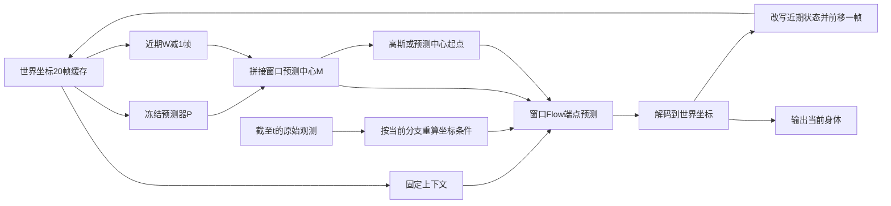

# 滚动窗口重建与成对反馈

2026-11-07。本文对应根目录 [plan.docx](../plan.docx) 的最新方案，包含公式和两个内嵌 Excel 对照表。统一入口为 `egorecover prepare/train/evaluate/experiments/restore`；所有运行代码位于 `egorecover` 包。旧实现保存在清理前归档分支。

状态：官方 EE4D 读取、无 E7 启动和基础训练链路已接通；完整实验与正式精度/延迟比较尚未完成。新增配置中的权重、噪声尺度和默认窗口是可运行的初始设置，并非实验选出的最优参数。

## 窗口、缓存与坐标

每帧仍为归一化的 243 维 `v4_beta` 表示。`WindowCache` 存储 20 帧世界坐标 `BodyState`、固定启动体型、启动参考坐标，以及最后提交的帧编号。官方首轮固定使用零 beta 平均体型。内部减去官方给定的常量 `floor_height`；零值作为未知地面标记保留，不用整段 GT 足点回填，并将地面相关指标置空。保存预测时同时输出 `joints_floor_world` 与恢复原始世界高度的 `joints_world`，并保存还原变换。

在时刻 t，缓存是 t−20…t−1；W 帧活动窗口是 t−W+1…t；固定上下文是 t−20…t−W，共 21−W 帧。预测器 P 始终读取完整 20 帧历史，而不是只读取固定上下文。各组都读取 t−20…t 的 21 帧原始图像和头部观测，W 改变时观测范围不变。



模型内的所有身体参考增量均相对于同一个公共参考：最近一次缓存身体的平面 heading/xy 参考。历史关节保留原有局部 9D 表示，内部参考增量由原来的相邻帧增量重新编码为相对这个公共参考的增量；每个活动帧均可独立解码到同一世界坐标。原始头部观测也按该分支的公共参考重新编码。官方首轮的 P 是无参数常速度外推：位置取 `2*p_last-p_previous`，旋转继续应用最近一次相对转动，辅助通道保持上一帧。它只读预测缓存，不读取 GT。可学习的残差 P 作为兼容选项单独记录权重身份，旧缓存上的 P 不用于当前实验。

在线输入只接受 `ObservationWindow`，其中包含 21 帧原始头部位姿、1024 维图像特征、两个有效性掩码及窗口末帧编号。输入缺失时先屏蔽无效载荷，再进行几何运算和线性投影。观测编号必须恰好是缓存末帧加一。

每轮更新将固定上下文与重建窗口拼接、移除最早一帧。改写仅作用于内部缓存；此前发出的公共输出不再更改。`revise_recent=false` 对照仅追加当前身体，近期旧状态保持原值。`body_feedback=false` 对照屏蔽全部身体上下文和预测中心，使用固定启动参考及高斯起点，仍读取完整 21 帧原始观测。

## 预测中心 Flow

中心 M 由近期 W−1 个缓存身体和 P 的当前身体拼接组成。两个起点共用同一个冻结 P、显式中心条件和标准噪声 ε：

- 高斯：S = σε。
- 预测中心：S = M + σε。

采用现有 x0 端点参数化，训练路径为 xτ = (1−τ)X* + τS，τ∈(0,1]。基础损失监督完整活动窗口；沿用 E7 对参考 9D 通道的 8 倍权重。默认 10% 的训练样本位于 τ=1，其余为 [0.001,1) 均匀抽样；两组使用相同比例。

Euler 从 τ=1 积分到 0，第 i 次更新为 x ← x + (x0(x,τ)−x)/(K−i)。因此一步求解严格等于网络在实际起点 S、τ=1 处的端点输出；两步、四步及十步保留完整梯度，不调用旧的 `no_grad` 采样接口。

`MotionModel` 保留源自 E7 的网络结构与必要窗口条件，但官方数据实验明确使用 `--from-scratch` 随机初始化，不载入 E7 权重。完整网络 dropout 为 `0.1`。旧数据路径的 E7 导入仅为兼容入口，官方训练拒绝该参数。`--compact` 采用相同前向路径与较小网络，dropout 为 `0`，只允许配合显式合成数据诊断。

## 训练参数与预算

优化器与训练稳定性参数对齐 UniEgoMotion 的固定提交 `580c92c6d70a91672c4106bab30ca82cdd80f379`，来源为 [config/uem.yaml](https://github.com/chaitanya100100/UniEgoMotion/blob/580c92c6d70a91672c4106bab30ca82cdd80f379/config/uem.yaml)、[module/uem_module.py](https://github.com/chaitanya100100/UniEgoMotion/blob/580c92c6d70a91672c4106bab30ca82cdd80f379/module/uem_module.py)、[run/train_uem.py](https://github.com/chaitanya100100/UniEgoMotion/blob/580c92c6d70a91672c4106bab30ca82cdd80f379/run/train_uem.py) 和 [model/uniegomotion.py](https://github.com/chaitanya100100/UniEgoMotion/blob/580c92c6d70a91672c4106bab30ca82cdd80f379/model/uniegomotion.py)。

| 参数 | 当前设置与口径 |
|---|---|
| 优化器 | AdamW，仅更新可训练 G |
| 初始学习率 | `3e-5`，可用 `--learning-rate` 设置 |
| Weight decay | `0.01`，可用 `--weight-decay` 设置 |
| AdamW betas / eps | `(0.9, 0.999)` / `1e-8` |
| 梯度裁剪 | L2 全局范数上限 `1.0`，可用 `--grad-clip-norm` 设置 |
| 移动 EMA | 每次 optimizer 更新后按 `0.999` 更新，供选模使用 |
| 有效 batch / microbatch | 默认 `64/8`；microbatch 梯度按有效 batch 加权累积 |
| 随机种子 | 首轮 `62`，正式重复为 `62/63/64` |
| 网络 dropout | 完整网络 `0.1`，合成 compact 诊断 `0` |
| 学习率调度 | 默认 `--lr-schedule uniegomotion`；gamma 默认 `0.1` |

官方按 epoch 使用 StepLR：350 epochs 预算，在 300 epochs 后首次把学习率乘以 `0.1`。本项目训练样本是独立采样的 online query，不存在遍历所有训练片段一次的同义 epoch，因此调度和预算统一用 optimizer update 记录。

默认调度使用官方训练清单的 `selected_clip_candidates` 作为 `N_ref`，按 `updates_per_reference_epoch = ceil(N_ref / effective_batch)` 换算，衰减点为 `300 × updates_per_reference_epoch`。这里使用未跳过短尾的官方候选数，不用当前可运行片段数冒充官方训练集大小，也不使用 microbatch 大小计算参考更新次数。

| 参考项 | 当前官方包、有效 batch=64 时的数值 |
|---|---:|
| 官方训练候选片段数 `N_ref` | 143,560 |
| 官方每 epoch 的更新次数，末批保留 | 2,244 |
| 官方 300 epochs 对应的衰减点 | 673,200 updates |
| 官方 350 epochs 对应的更新次数 | 785,400 updates |
| 示例 pilot | 2,400 updates / 153,600 online queries |

在此默认配置下，更新 1…673200 使用 `3e-5`，第 673201 次更新起使用 `3e-6`。`--lr-decay-step` 可显式覆盖衰减点，`--lr-decay-gamma` 设置倍数；固定学习率实验使用 `--lr-schedule constant`。合成诊断没有官方参考片段数，未显式设置衰减点时不自动衰减。短 pilot 不把衰减点按预算比例压缩到末段，因此 2400 更新的试跑处于官方参考调度的初始学习率阶段。

785400 updates 是“相同更新次数”的参考预算，不表示本项目训练了 350 个 epoch，也不表示监督量与上游一致：官方 350 epochs 实际访问 50,246,000 个 clips，末批不足 64；本项目 785400 次满 batch 对应 50,265,600 个 online queries。上游每个 clip 最长 80 帧，本项目每个 query 的目标是 W 帧活动窗口，采样分布和辅助监督也不同。正式报告需同时记录有效 batch、optimizer updates、累计 queries、窗口、roll-in、初始化及总训练成本。

先用标明为 pilot 的共同短预算检查学习曲线与计算成本，再确定正式预算；若选择完整更新次数参考，则显式把 `--train-steps` 设为 `785400`。配置生成与本文说明不会自动启动该训练。20 帧历史、21 帧观测、W=1/3/5/10、默认 4 帧 roll-in、噪声尺度 σ、Flow 端点比例和反馈权重均属于本方案控制项；上游 80 帧片段和 1000 个 diffusion 时步不能机械替代这里的在线窗口或 Euler 求解步数。

`--resume` 继续原优化器与学习率时钟；`--initialize` 从共同预热 EMA 开始一个新实验，优化器和学习率时钟均重置。所有继续训练对照使用同一重置策略及相同新增 query 预算，不把预热成本从总成本中省略。

## 成对反馈及梯度边界

1. 当前可训练 G 完成实际起点的窗口求解，得到当前身体 X̂ 和已修正的近期过去。
2. 两份后续缓存共享本轮修正过的过去部分，并对共同部分停止梯度。
3. 预测分支在 t 写入 X̂，保留输入梯度；参考分支仅在 t 写入一次 X*，停止梯度。
4. 两条分支读取相同的 t+1 原始观测、标准噪声、固定启动体型和求解设置，分别重算完整历史编码、P、中心、公共参考和观测条件。
5. 冻结后续模型求解后，将双方当前身体以同一个 `FixedShapeFK` 解码为同体型、同世界坐标的 SMPL22 位置，最小化预测响应与停止梯度的参考响应之间的距离。

`HistoryPrior.freeze()` 冻结参数并锁定 eval 模式，同时保留对输入的梯度。调用方需要无梯度推理时，使用外部 `torch.no_grad()`；冻结参数本身不应截断完整后续映射。

首轮的后续模型使用初始化 EMA 的**固定快照**，训练过程中不更新该快照。成对/直接后续监督的比较使用相同预热 checkpoint，因此后续模型在整个比较中一致。另维护一份移动 EMA 专门用于开发集选模，两者分别保存在 `feedback_model` 和 `ema` 中。P、后续快照和 SMPL 参数均不接收参数梯度。

总目标为基础窗口 Flow 损失 + λcur 当前身体监督 + λfb 后续反馈。几何项使用关节平方欧氏误差的样本/关节均值，并除以 `scale_m²`；这与文档中向量平方范数相差一个固定归一化系数，由辅助权重吸收。后续噪声多次采样取平均。

支持五种 `feedback` 设置：`none`、`paired`、`direct`、`feature`、`geometry`。`direct` 用预测分支后续输出与下一帧同体型真值比较；其后续模型、输入梯度和求解设置与 `paired` 相同。`feature` 是当前归一化 243 维误差，`geometry` 是固定几何误差，用于检验完整响应度量相对固定度量的额外价值。

## 四组实验与公平对照

按“在线窗口 → 预测中心起点 → 成对监督 → 组合”的顺序推进；前一阶段固定结论和控制设置后再开展下一阶段。`egorecover experiments --window 3 --output exp/window_plan/configs` 输出矩阵和每个组的 JSON，不自动启动训练。窗口 3 只是初始示例，实验一完成后应先在开发集选择窗口，再重新生成后续矩阵。

| 实验 | 实现的比较 |
|---|---|
| 一：在线窗口 | W=1/3/5/10，高斯起点、仅基础 Flow 损失；同窗口固定近期状态对照；同观测范围无身体反馈对照 |
| 二：预测中心 | 高斯与预测中心，共享 P 与显式中心，匹配初始化/尺度/训练预算/端点比例；同缓存单次重建与自身缓存连续重建；评估 1/2/4/10 步 |
| 三：反馈 | 当前监督基线、成对反馈、直接后续真值监督；补充固定特征与几何对照；后续 1/2/4/10 帧诊断及独立连续运行 |
| 四：组合 | A 高斯/无反馈，B 预测中心/无反馈，C 高斯/成对反馈，D 预测中心/成对反馈；复用 A/B/C，只补 D |

为保证续训预算一致，矩阵显式区分 `warmup/*` 与正式比较：

- `source/gaussian`、`feedback/paired`、`feedback/direct` 和固定度量对照都从 `warmup/gaussian` 的相同 EMA 开始，用相同预算继续训练。`feedback/base` 复用 `source/gaussian`。
- `source/prediction` 与 `combination/D` 都从 `warmup/prediction` 的相同 EMA 开始，用相同预算继续训练。
- A/B/C 是对应结果的引用，不能再次训练并重复累计预算。
- 所有组按相同种子、take 划分、模型结构、启动缓存、体型、标准噪声规则及原始观测区间运行。配置生成器给出种子 62/63/64，启动命令需逐个传入。
- 训练噪声按 episode/step/sample/draw 独立确定，先生成十个槽位再切取窗口；改变 W 或反馈 draw 数不改变训练样本、插值时间的随机序列，各窗口的当前帧噪声也一致。

官方训练先按 take、源段与 query 独立采样，读取 query 前 20+rollin 帧及当前/下一帧的小片段。最初 20 帧身体来自逐帧头部观测对齐的中性模板：仅使用平面朝向，把 SMPL15 近似放到 Aria 设备原点，固定零 beta，不声称已完成设备到头部的外参标定。随后进行默认 4 帧当前 G 的无梯度 roll-in，再做当前与后续训练；`--rollin-frames` 写入实验身份。训练不把 GT 身体写入常规历史；仅配对参考分支在指定当前时刻写入一次标签。独立连续评估同样以前 20 帧头部模板启动，之后全程推进自身缓存。

组合交互项为 (A−D)−(A−B)−(A−C) = B+C−A−D；正值表示超过独立收益之和。`interaction()` 返回该项及其他差值。判断稳定性时应先按相同种子、take 配对，再汇总种子间变化。

## 运行与恢复

安装及完整命令见 [README](../README.md)；数据、固定版本资产与坐标协议见 [数据协议](data.md)。新版仅使用统一命令：

```bash
egorecover train --config configs/paired.json --synthetic --compact \
  --output exp/smoke --train-steps 2 --batch-size 1 --eval-every 1
egorecover evaluate --checkpoint exp/smoke/best.pt --synthetic \
  --output exp/smoke-evaluation --steps 1 2 4 10
egorecover experiments --window 3 --output exp/configs
```

训练输出 `identity.json`、完整 `resume.pt`、开发集选出的 `best.pt`、`selection.json`、`dev.json`。`--resume` 恢复模型、固定后续快照、移动 EMA、优化器、采样/CPU/CUDA 随机状态；需使用相同参数、代码、资产和输出路径。`--stop-after N` 保存后提前结束本次会话，不改变总预算。`--initialize` 是从预热模型开始新实验，与精确恢复互斥。

新版 checkpoint 明确记录 `model_config` 和 `egorecover_window_v2` 格式，导入原 E7/P 与原生恢复分别处理；不自动解释旧的单帧/潜变量模型。默认网络保留完整 E7 尺寸，`ModelConfig.compact()` 只用于合成诊断，两个尺寸共用同一前向实现。

实验身份锁定数据协议、P 模式或权重、SMPL-X、初始化、包内源代码和预算。官方数据大文件以大小与修改时间记录身份，注释和统计小文件记录 SHA256；这不等于每次重算全部载荷哈希。读取时检查官方 take 划分、张量形状和训练统计。时间由原始 30Hz 帧号、stride=3 推导并验证，当前身体为 10Hz；5Hz DINO 的 CLS token 0 按原时间轴零阶保持，不读取未来特征。后续 1/2/4/10 帧对应 0.1/0.2/0.4/1 秒。

评估分别报告数据集 GT 的 `body_mm`、固定启动体型的 `same_shape_mm`、中心误差与延迟，episode 内平均后再对 take 等权。延迟含 P、坐标编码、求解、缓存更新和 FK，排除磁盘加载与噪声生成；CUDA 在边界同步，首帧单列。预测按需保存地面归零及原始世界两种坐标。

## 验证范围

```bash
PYTEST_DISABLE_PLUGIN_AUTOLOAD=1 pytest -q
```

测试覆盖缓存/坐标、因果范围、噪声配对、损失反传、共同过去停止梯度、冻结 P 输入梯度、无身体反馈独立性、数据完整性、资产恢复、E7/EMA 导入、命令行及精确恢复。清理前完整尺寸模型与新模型加载相同 E7 权重后的窗口输出另做数值比对。

合成模式使用 dense 关节诊断；官方训练使用授权 SMPL-X 固定零 beta 体型 FK。真实数据短训练用于检查反传、恢复和评估入口，不代表收敛或正式 GPU 性能实验；默认超参数没有被验证为最优。
