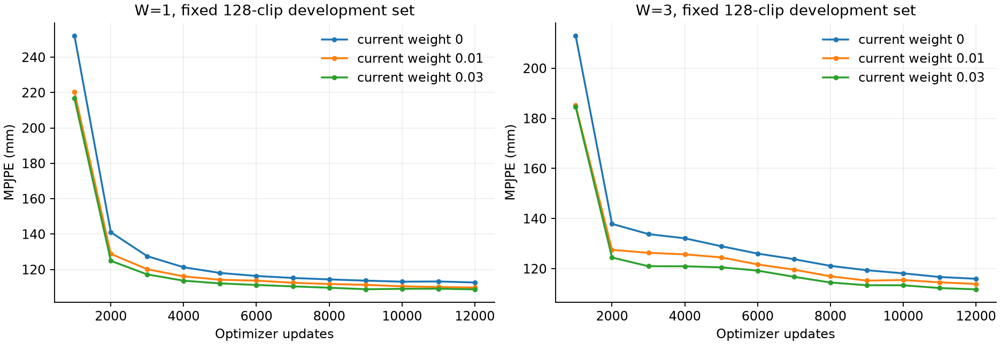
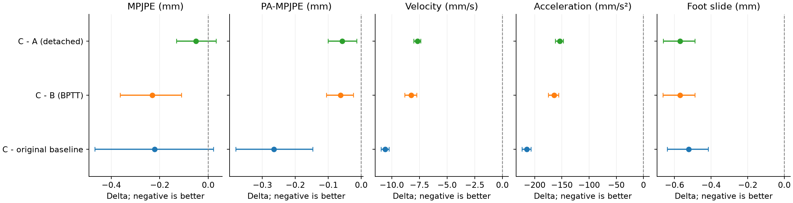
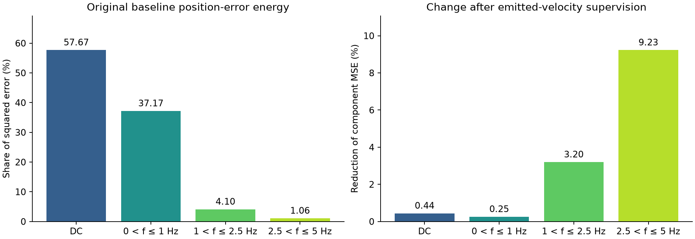

# EE4D 在线重建实验报告

统计快照：2026-11-11T14:01:45+08:00。对应实现：`879546c10aa3aa44d0b5e847bc96498833070d44`。实验只使用官方EE4D train和val；未将val称为独立test。

当前较明确的进展来自成熟预测历史适配：W3在回写开启时从99.338降至92.268 mm。追加真实输出速度监督后，速度、加速度和脚滑进一步改善，但相对该92.268 mm基线的MPJPE变化只有−0.221 mm，95%区间包含0。预测中心、更多求解步数和固定参考分支的成对训练均尚未形成稳定的全面优势。

新一轮“预测体型参与FK与真实关节监督”和“在此基础上增加多尺度持续偏差监督”处于`waiting_for_SIMPLE_and_eight_idle_gpus`，截至快照没有正式训练结果。本报告将它们列为待验证实验。

完整数值见[指标CSV](data/metrics.csv)、[配对变化CSV](data/paired_effects.csv)、[汇总JSON](data/experiment_summary.json)和[来源清单](data/source_manifest.json)。公开文件只包含汇总统计，不包含数据集、SMPL-X模型或训练权重。

独立重算的[复核记录](data/report_review.json)覆盖全量验证的take等权均值、最新四组1600条片段结果以及144项配对置信区间。该记录是本次归档的核对结果，重新生成报告后需重新核对。

## 评测口径

| 结果类别 | 范围与主聚合 | 用途 |
| --- | --- | --- |
| 早期完整验证 | 4379片段，537 takes，take等权 | 窗口与当前帧权重选择 |
| 原生minival | 固定128片段，take等权 | 训练曲线与阶段选模 |
| 后续固定400验证 | 400个完整80帧片段，212 takes，片段等权 | 起点、求解器、历史、连续训练等消融 |
| P预测诊断 | 同一400片段产生的匹配冻结G历史，take等权 | 预测中心自身的误差，不是最终G重建误差 |
| 单帧GT干预 | 400片段，成熟锚点40和60，成对噪声1062至1064 | 检查参考方向与影响持续时间 |

固定400选择SHA256为`07c11f0bb0d7393e8384d5b427682cd88ba754142a2023298e66e7c71b5720b9`。每段10 Hz、80帧，前20帧建立头部中性启动历史，只评分20至79帧的首次输出，共24000帧。不同片段分别重置历史，**这不是整条take不重置的连续评测**，也不是原论文完整80帧评分。

已完成实验以固定零体型进行最终FK，输入为头部轨迹与官方DINOv2 CLS特征；5 Hz特征向10 Hz身体时刻作因果保持。没有把官方额外register tokens当作图像patch。20帧身体历史由系统自身滚动产生；W3每次联合输出过去2帧与当前帧，历史修正只供内部后续使用，不修改已经发出的公共输出。

初始G从随机权重训练，不加载E7。后续明确标为续训的实验使用本项目已有G检查点和新优化器；不同阶段的追加训练预算不能省略。公开指标函数与[比较协议](../comparison.md)给出坐标、时间和对齐定义。

| 指标 | 本报告定义 |
| --- | --- |
| MPJPE | 22个身体关节的世界坐标欧氏误差，mm，不做根对齐 |
| PA | 逐帧含尺度旋转平移的相似对齐，禁止镜像，mm |
| 速度与加速度误差 | 真实时间戳下差分与GT差分的误差，mm/s和mm/s² |
| 脚滑 | `foot_slide_uniegomotion_mm`，沿用当前上游实现，mm |
| Wrist PE | 身体关节20和21的误差，不能替代手指MPJPE |
| 手指MPJPE | SMPL-X关节25至54的补充统计，使用官方拟合参数作为标签 |
| 头部误差 | 头关节15、左眼关节23和旋转矩阵误差分列，不互换 |
| 最低网格离地 | 每帧网格最低点离地高度绝对值的均值，mm，不是接触分类准确率 |

手PCA通道沿用Flow监督；已完成实验没有新增手指几何损失。官方SMPL-X手参数是拟合标签，不能解释为独立人工手部真值。FID、Semantic和EgoForce原论文PJ/AUJ尚未统一复评，本报告不以其他平滑指标冒充它们。

## 窗口与当前帧权重

以下均训练到12000步并选择12000步检查点，在完整4379片段上take等权汇总。基础优化器为AdamW，学习率3e−5，weight decay 0.01，梯度裁剪1，EMA 0.999，seed 62。单种子短预算不代表已收敛。

| W | 当前帧权重 | MPJPE mm | PA mm | 速度 mm/s | 加速度 mm/s² | 脚滑 mm |
| --- | --- | --- | --- | --- | --- | --- |
| 1 | 0.000 | 111.241 | 64.543 | 380.980 | 5004.092 | 27.798 |
| 3 | 0.000 | 113.017 | 65.060 | 340.828 | 4166.883 | 24.061 |
| 5 | 0.000 | 113.870 | 65.669 | 342.867 | 4175.836 | 23.835 |
| 10 | 0.000 | 113.387 | 66.701 | 355.410 | 4380.138 | 25.635 |
| 1 | 0.010 | 109.048 | 63.198 | 336.963 | 4130.046 | 20.577 |
| 3 | 0.010 | 111.452 | 64.506 | 318.779 | 3748.475 | 18.416 |
| 1 | 0.030 | 108.211 | 62.090 | 330.162 | 3994.979 | 20.187 |
| 3 | 0.030 | 109.176 | 63.545 | 310.311 | 3637.575 | 18.410 |

基础Flow下W1的MPJPE最低，W3和W5的时序指标较低；W越大并未带来单调收益。当前帧权重0.03比0.01在这两种窗口下进一步降低全量MPJPE。W1更偏向位置精度，W3保留连续性研究价值，不能概括为W3全面更好。

早期四窗口的单帧GT干预、实用三类比例与共同完整片段核验见[四窗口复核记录](../window_comparison_20261108.md)；CV中心变化与窗口条件路径的进一步检查见[条件路径诊断](../reference_paths_20261108.md)。这些阶段记录保留各自的检查点与样本范围。

W1在相同2000步原生minival上的权重筛选如下。0.003只进行了2000步试验，不能推断其12000步成绩。权重1的早期运行因梯度尺度不平衡停止，详见[几何梯度审计](../geometry_gradient_audit_20261108.md)；本报告不将停止运行当作完整基线。

| W1 当前帧权重 | 2000步 minival MPJPE mm |
| --- | --- |
| 0 | 141.087 |
| 0.003 | 133.035 |
| 0.010 | 128.809 |
| 0.030 | 124.906 |

## 固定400片段的窗口与起点

CV加高斯起点的12000步结果：

| 设置 | MPJPE mm | PA mm | 速度 mm/s | 加速度 mm/s² | 脚滑 mm |
| --- | --- | --- | --- | --- | --- |
| W1 高斯 | 95.968 | 56.467 | 235.955 | 3085.668 | 13.855 |
| W3 高斯 | 98.804 | 59.726 | 217.199 | 2733.154 | 11.583 |

W3相对W1的MPJPE增加2.836 mm，配对95%区间[1.482, 4.328]；速度、加速度和脚滑更低。它说明这两个窗口在当前模型中存在精度和时序表现的权衡。

CV预测中心起点的对应结果：

| 窗口 | 起点 | MPJPE mm | PA mm | 速度 mm/s | 加速度 mm/s² | 脚滑 mm |
| --- | --- | --- | --- | --- | --- | --- |
| 1 | CV预测中心 | 98.119 | 56.528 | 249.815 | 3243.808 | 15.848 |
| 3 | CV预测中心 | 99.761 | 60.263 | 226.657 | 2838.596 | 12.083 |

W1预测中心相对高斯起点的MPJPE增加2.151 mm；W3增加0.957 mm，其位置差异区间跨0。当前设置不能支持“使用CV中心即能普遍提高重建”的结论。

## 学习预测器及其对最终重建的影响

下表是P在匹配的冻结G历史上预测当前身体的误差，全部使用60个后启动时刻、take等权。它与最终G的400片段片段等权表不同。

| 预测器 | 选中步数 | 历史来自W | P误差 mm | CV误差 mm | P减CV mm |
| --- | --- | --- | --- | --- | --- |
| 初版P | 12000 | 1 | 104.478 | 111.298 | -6.820 |
| 初版P | 12000 | 3 | 104.591 | 109.138 | -4.547 |
| 成熟历史P | 6000 | 1 | 103.192 | 111.298 | -8.106 |
| 成熟历史P | 6000 | 3 | 102.460 | 109.138 | -6.678 |
| Two Forward P | 12000 | 1 | 103.289 | 111.298 | -8.009 |
| Two Forward P | 12000 | 3 | 102.442 | 109.138 | -6.695 |

成熟历史P和Two Forward P在位置上优于匹配CV，但两者的成熟历史位置误差几乎相同：W1变化−0.031 mm，95%区间[−0.287, 0.220]；W3变化+0.133 mm，区间[−0.113, 0.381]。Two Forward轮次同时改变了训练课程与历史混合，不能将全部差异归因于一次Two Forward机制。

成熟历史P的早期版本在脚滑、加速度上没有同时通过相对CV的门槛。P的历史适配过程及补充时序统计保存在汇总JSON，不把预测器通过位置门槛等同于最终重建获益。

冻结新P后，两种起点的G各训练12000步，实际最终重建为：

| 设置 | MPJPE mm | PA mm | 速度 mm/s | 加速度 mm/s² | 脚滑 mm |
| --- | --- | --- | --- | --- | --- |
| CV_gaussian | 98.804 | 59.726 | 217.199 | 2733.154 | 11.583 |
| P_gaussian | 97.875 | 59.481 | 215.653 | 2718.609 | 11.363 |
| CV_prediction | 99.761 | 60.263 | 226.657 | 2838.596 | 12.083 |
| P_prediction | 97.738 | 59.126 | 221.589 | 2810.195 | 12.180 |

新P对高斯和预测中心路线的MPJPE分别改善0.929和2.023 mm。新P条件下预测中心相对高斯只低0.138 mm，95%区间[−1.214, 1.035]；预测中心的速度、加速度与脚滑也没有全面占优。

## 求解步数与历史回写

对按一步几何监督训练的既有CV检查点，只改变求解步数，不重新训练：

| 设置 | MPJPE mm | PA mm | 速度 mm/s | 加速度 mm/s² | 脚滑 mm | 核心时延 ms |
| --- | --- | --- | --- | --- | --- | --- |
| gaussian NFE=1 | 98.804 | 59.726 | 217.199 | 2733.154 | 11.583 | 30.118 |
| gaussian NFE=2 | 103.383 | 61.550 | 371.581 | 5796.600 | 25.800 | 43.244 |
| gaussian NFE=4 | 110.785 | 64.913 | 504.362 | 8276.045 | 36.755 | 69.701 |
| prediction NFE=1 | 99.761 | 60.263 | 226.657 | 2838.596 | 12.083 | 30.206 |
| prediction NFE=2 | 110.453 | 66.927 | 357.239 | 5319.428 | 25.227 | 43.385 |
| prediction NFE=4 | 119.206 | 73.091 | 460.067 | 7295.085 | 33.151 | 69.626 |

增加步数在这两份检查点上恶化精度与时序结果。它检验的是现有一步训练检查点的步数敏感性，**不能据此否定经过专门训练或蒸馏的多步方法**。时延另在相同设备的16片段、944个稳定帧上隔离测量，包含P、Flow、回写与解码，排除视觉编码和SLAM；不把并行质量评测耗时作为该时延。

使用新P和既有W3检查点，仅在推理关闭过去槽位回写：

| 设置 | MPJPE mm | PA mm | 速度 mm/s | 加速度 mm/s² | 脚滑 mm |
| --- | --- | --- | --- | --- | --- |
| gaussian_on | 97.875 | 59.481 | 215.653 | 2718.609 | 11.363 |
| gaussian_off | 95.836 | 58.136 | 214.784 | 2733.389 | 11.586 |
| prediction_on | 97.738 | 59.126 | 221.589 | 2810.195 | 12.180 |
| prediction_off | 95.747 | 58.012 | 220.840 | 2820.720 | 12.461 |

关闭回写使两种起点的MPJPE各下降约2 mm，但加速度和脚滑略差。这是推理策略干预，不能直接当作匹配训练历史后的最佳策略，也不能证明回写造成大部分抖动。

随后从同一高斯加新P预训练G续训四组，每组追加2000步，交叉比较历史训练与回写策略：

| 设置 | MPJPE mm | PA mm | 速度 mm/s | 加速度 mm/s² | 脚滑 mm |
| --- | --- | --- | --- | --- | --- |
| A_short_on | 99.338 | 59.394 | 213.441 | 2672.545 | 11.156 |
| B_short_off | 108.094 | 63.637 | 221.224 | 2810.144 | 10.575 |
| C_mixed_on | 92.268 | 54.222 | 210.780 | 2668.379 | 13.084 |
| D_mixed_off | 92.182 | 54.090 | 211.660 | 2698.722 | 13.224 |

short表示4帧roll-in；mixed表示75%成熟20帧roll-in与25%启动0、1、4帧roll-in。回写开启时mixed比short的MPJPE降低7.070 mm，95%区间[−9.059, −5.297]；但脚滑增加1.928 mm。成熟历史适配对当前位置精度的贡献较明确，却没有同时解决所有时序问题。

mixed下关闭回写相对开启的MPJPE变化−0.086 mm，95%区间[−0.311, 0.081]；速度、加速度、脚滑均略差。因此继续以mixed加回写开启的C设置作为共同基础。

## 单帧GT干预的参考分支诊断

在C设置的成熟锚点40和60，只将当时身体姿态替换为GT，其他历史仍保留预测值；下一时刻的新观测正常到达，两条分支使用相同噪声。收益定义为Epred减Eref，正数表示参考更好。

| 后续帧数 | Epred mm | Eref mm | 收益 mm | 收益95%区间 | 更好 % | 近似 % | 更差 % |
| --- | --- | --- | --- | --- | --- | --- | --- |
| 1 | 91.215 | 89.510 | 1.705 | [1.3515, 2.0412] | 52.500 | 33.125 | 14.375 |
| 2 | 91.401 | 91.154 | 0.247 | [0.1969, 0.2983] | 6.500 | 92.250 | 1.250 |
| 4 | 92.038 | 92.020 | 0.018 | [0.0110, 0.0263] | 0.250 | 99.625 | 0.125 |
| 10 | 93.438 | 93.435 | 0.003 | [0.0003, 0.0055] | 0.000 | 100.000 | 0.000 |

每个horizon有400片段、212 takes、800个锚点单位和2400个成对draw。三类比例先对配对draw平均，再以锚点分类，±1 mm内为近似；这不是把每个draw当作独立样本。

h=1时实用变差占14.375%；若不设置1 mm容差，严格Eref大于Epred占27.5%。完整状态干预的h=1收益1.707 mm，三类比例为53.875%、30.625%、15.500%，与身体姿态干预的平均结论相近。

收益从下一帧1.705 mm快速衰减至后续10帧0.0027 mm。它支持当前写入对近期响应存在影响，但不是完整GT历史的性能上限，也不能把干预收益当作成对训练已经获得的提升。参考下一帧自身仍有约89.510 mm误差。

当前缓存直接位置与最终FK位置差异约31.066 mm；其中包含体型差异，不能将其全部视作可消除的模型错误。按GT身体写入后重新计算中心，也不保证新中心更适合已训练的G。

## 连续训练与成对监督

从共同C基础各追加2000步：

| 设置 | MPJPE mm | PA mm | 速度 mm/s | 加速度 mm/s² | 脚滑 mm |
| --- | --- | --- | --- | --- | --- |
| C_baseline | 92.268 | 54.222 | 210.780 | 2668.379 | 13.084 |
| two_step | 92.277 | 54.020 | 208.420 | 2618.227 | 13.131 |
| paired_one_step | 92.549 | 54.111 | 212.931 | 2710.542 | 13.877 |

two_step连续调用两次并保留跨缓存梯度；paired_one_step对当前身体的一次干预形成固定参考响应并监督成对一致性。两组都有128000个锚点，但two_step直接监督256000个当前身体，paired只有128000个，属于路线筛选而非完全等标签预算比较。

连续两步对原C的MPJPE基本持平；该版本成对监督的MPJPE、速度、加速度和脚滑没有改善。参考分支有时更差、影响短暂且自身误差较大，是解释结果的候选因素，当前实验没有逐项识别它们各自的因果贡献。

## 停止梯度与真实输出速度监督

在相同共同C初始化上，A为连续两次调用但停止跨缓存梯度；B保留跨缓存梯度；C在B上增加真实输出速度监督，权重0.013409926806430328，速度尺度1 m/s。A、B、C均追加2000步、128000个锚点、256000个直接监督身体；原C不追加训练。

| 设置 | MPJPE mm | PA mm | 速度 mm/s | 加速度 mm/s² | 脚滑 mm |
| --- | --- | --- | --- | --- | --- |
| C_baseline | 92.268 | 54.222 | 210.780 | 2668.379 | 13.084 |
| B_two_step | 92.277 | 54.020 | 208.420 | 2618.227 | 13.131 |
| A_two_step_detached | 92.096 | 54.015 | 207.856 | 2608.245 | 13.133 |
| C_two_step_velocity | 92.046 | 53.957 | 200.186 | 2454.184 | 12.562 |

| 设置 | 手腕 mm | 手指 mm | 头关节 mm | 头旋转 F | 左眼平移 mm | 最低网格离地 mm | Root Final mm |
| --- | --- | --- | --- | --- | --- | --- | --- |
| C_baseline | 148.113 | 176.044 | 44.038 | 0.230 | 45.880 | 45.223 | 65.859 |
| B_two_step | 147.839 | 175.673 | 44.257 | 0.230 | 46.157 | 45.711 | 66.284 |
| A_two_step_detached | 147.796 | 175.677 | 44.004 | 0.230 | 45.898 | 45.678 | 65.726 |
| C_two_step_velocity | 147.645 | 175.526 | 44.284 | 0.230 | 46.098 | 45.288 | 64.994 |

C相对原C的速度误差下降5.026%，加速度下降8.027%，脚滑下降3.986%。MPJPE变化−0.221 mm，95%区间[−0.468, 0.022]，尚不能给出明确位置改善结论。头关节误差还从44.038增至44.284 mm，因此不存在所有指标同时改善。

预算相同的C对B，MPJPE变化−0.230 mm，95%区间[−0.363, −0.110]；但C对A只有−0.050 mm，区间[−0.131, 0.033]。停止跨缓存梯度的A位置表现与C接近，不能把完整跨步反传视为当前收益的必要条件。C的时序指标优于A。尚未完成“A停止梯度加速度监督”的第四个组合。

各成对区间见配对CSV。这些区间只刻画固定检查点与当前验证片段的采样不确定性，不代表多训练种子波动；多指标比较未做多重校正。

## 误差瓶颈与体型诊断

对既有保存轨迹的6秒评分区间，令每关节误差为预测减GT，做精确MSE分解与频谱统计：

| 误差成分 | 原C平方误差占比 % | 速度监督C相对减少 % |
| --- | --- | --- |
| 片段时间均值 DC | 57.670 | 0.439 |
| 大于0至1 Hz | 37.174 | 0.255 |
| 大于1至2.5 Hz | 4.101 | 3.197 |
| 大于2.5至5 Hz | 1.055 | 9.227 |

原C的DC与不超过1 Hz成分合计约94.844%的平方位置误差。速度监督对高频误差的减少较大，对持续偏差的减少较小；去掉每帧所有关节共同平移后，仍约70%的平方误差属于姿态相关部分。

DC是每个片段内各关节误差的时间均值，不是跨数据总体的统计偏差，也不是不可约误差。频率分解说明误差结构，不单独证明输入不足或模型结构是原因。相邻帧差分会抵消恒定位置偏差，因此后续多尺度监督将补充对该部分的直接优化。

保持C预测的旋转与骨盆位置，只改变解码体型：

| 解码设置 | MPJPE mm |
| --- | --- |
| 预测姿态＋固定零体型 | 92.046 |
| 同一预测姿态＋GT体型诊断 | 88.100 |

平均改善3.946 mm，配对take簇95%区间[2.768, 5.270]。改善超过1 mm的片段占51.75%，±1 mm内占22%，恶化超过1 mm占26.25%。GT体型仅用于离线诊断，不是允许的推理输入、学习体型的保证收益或严格数学上界。

另将官方GT参数用已上传SMPL-X资产解码，身体关节平均差约0.000078 mm，支持这一部分的资产和关节约定一致。速度监督后的脚滑改善主要伴随水平脚位移下降；GT接触高度加权的补充脚滑从6.979降至6.601 mm，不能概括为简单抬脚规避脚滑。

## 排队中的两组实验

状态快照时间为2026-11-11T14:01:21+08:00，状态为`waiting_for_SIMPLE_and_eight_idle_gpus`。当前没有两组的新训练或验证成绩。

| 设置 | A 体型和真实关节 | B 增加持续偏差 |
| --- | --- | --- |
| 显卡 | 0至3 | 4至7 |
| 最终解码 | 每次输出的预测体型参与FK | 相同 |
| 当前几何标签 | 官方真实身体关节 | 相同 |
| 当前帧权重 | 0.03 | 0.03 |
| 连续监督调用 | 8次真实时间推进，状态间停止梯度 | 相同 |
| 真实输出速度权重 | 0.013409926806430328 | 相同 |
| 持续偏差权重 | 0 | 0.03 |
| 池化尺度 | 计算并记录2、4、8帧误差 | 用于额外监督 |
| 共同设置 | W3、高斯起点、NFE1、冻结新P | 相同 |
| 预算 | 2000步，16锚点每步，微批2 | 相同 |
| 直接监督量 | 每步128身体，共256000身体 | 相同 |
| 初始化 | 同一已有C速度监督最终EMA，新优化器 | 相同 |
| 评测 | 500步一次128片段，最终同一400片段 | 相同 |

持续偏差损失对实际连续输出的有符号误差e做2、4、8帧重叠块平均，再对均值平方误差按尺度等权平均；归一化位置尺度为0.1 m。每个输出仍保留自己的参数梯度，逐帧位置监督和真实运动速度监督继续保留。推理不访问未来观测或GT体型，未在这轮加入新的P与G门控校正器。

B减A可比较该多尺度监督的额外作用；A与旧两步基线相比还改变了训练horizon、锚点batch、体型与几何目标，不能把全部差异单独归因于体型。普通位置损失增权对照尚未包含，未来需要检验收益是否只是位置权重重分配。

实现提交`879546c`已完成376项全套测试及6项新增检查，包含双进程8帧训练精确恢复、有符号持续偏差的梯度、官方目标读取和排队策略。CPU真实资产检查验证了预测体型梯度与骨盆对齐；GPU试跑在资源释放后进行。技术检查不是训练精度结果。

## 外部论文比较边界

本报告没有重新运行UniEgoMotion或EgoForce，不把论文发表数字放入同口径排名。离线方法可按窗口推理并拼接，在线方法按时间滚动，最终都须在同一片段、有效帧、关节与坐标上评分，再单列Online与隔离实测Time。

[UniEgoMotion](https://arxiv.org/html/2508.01126v1)的完整80帧、其余任务设置与本项目后启动60帧不同；[EgoForce](https://arxiv.org/html/2605.13041v1)另接收带可见性掩码的手腕位姿。不能直接据本报告数值宣称超越它们。[EgoPriMo](https://arxiv.org/html/2606.08495v2)的Nymeria重建与EE4D生成也不能混入本项目EE4D在线重建排名。单次参考干预的后续重建不是遮断未来观测的动作预测任务。

体型参与几何与一致性约束可参考[HuMoR](https://arxiv.org/html/2105.04668)、[WHAM](https://arxiv.org/html/2312.07531)和[EgoPoser](https://arxiv.org/html/2308.06493)。多尺度运动与频率目标可参考[AvatarJLM](https://arxiv.org/html/2308.08855)、[FreDF](https://arxiv.org/html/2402.02399)和[Focal Frequency Loss](https://arxiv.org/html/2012.12821)。普通正交频域等权平方误差与时域MSE等价；本项目的新项通过有符号时间池化改变误差权重，其有效性仍须实验检验。

P提供可信度先验、G结合观测进行状态校正的后续研究可借鉴[KalmanNet](https://arxiv.org/html/2107.10043)。这属于尚未实现的结构方向，不作为本报告的已验证贡献。


## 图表



图1为同一窗口内不同当前帧权重的原生128片段验证曲线，不能与400片段表直接比较。它呈现有限预算内的学习过程，不能单凭验证曲线证明不存在过拟合。



图2使用固定400片段的take簇2000次bootstrap区间。横轴是C减对照，负值表示误差下降；不同面板单位不同。原C没有追加本轮2000步，A和B与C有相同追加训练预算。



图3左侧为原C的平方位置误差分解，右侧为速度监督C在各成分上的相对减少；这些百分比不能解释为MPJPE的可加分解。


## 复核与复现

汇总CSV保留评测cohort和聚合方式，JSON保留完整精度小数、辅助指标、配对区间、P诊断与待验证设置。来源清单包含每个本地结果文件的SHA256与字节数；下表SHA为前16位，完整值见JSON。`exp/`是本地实验产物，GitHub只保存可审阅的汇总快照。

| 本地来源 | SHA256前16位 |
| --- | --- |
| `exp/official-clip400-20261108/selection.json` | `7723552e557f01ae` |
| `exp/official-clip400-20261108/comparison.json` | `c45e6c8be6ddcdd0` |
| `exp/prediction-center-0p03-20261109/evaluation400/comparison.json` | `6f3873525b0d86a1` |
| `exp/solver-steps-W3-20261109/comparison.json` | `fdcad878a14f17ea` |
| `exp/learned-prior-G-W3-20261109/evaluation400/comparison.json` | `f096501679912751` |
| `exp/history-rewrite-newP-W3-20261110/comparison.json` | `958904ee8f172e4d` |
| `exp/history-policy-ablation-20261110/evaluation400/comparison.json` | `0fb52d896b8ab4a2` |
| `exp/two-step-vs-paired-C-20261110/evaluation400/comparison.json` | `60a799f5203d1e74` |
| `exp/ac-detach-velocity-C-20261110/evaluation400/comparison.json` | `69959f9e5f66ee6a` |
| `exp/window-selection-20261107/W1/full-dev.json` | `4857ef0c053d75b4` |
| `exp/window-selection-20261107/W1/selection.json` | `ea07894943015acd` |
| `exp/window-selection-20261107/W3/full-dev.json` | `d770d2915a9cba62` |
| `exp/window-selection-20261107/W3/selection.json` | `6072d3060b2955be` |
| `exp/window-selection-20261107/W5/full-dev.json` | `af65e9fe10a9a348` |
| `exp/window-selection-20261107/W10/full-dev.json` | `adeb4e034fc657ad` |
| `exp/current-geometry-0p01-20261108/W1/full-dev.json` | `91ce990134d74943` |
| `exp/current-geometry-0p01-20261108/W1/selection.json` | `36a65146a520424f` |
| `exp/current-geometry-0p01-20261108/W3/full-dev.json` | `e44251b369ed8dad` |
| `exp/current-geometry-0p01-20261108/W3/selection.json` | `5a3b1d2d2a387735` |
| `exp/current-geometry-0p03-20261108/W1/full-dev.json` | `1035188c792c8acd` |
| `exp/current-geometry-0p03-20261108/W1/selection.json` | `e028b279f029a6be` |
| `exp/current-geometry-0p03-20261108/W3/full-dev.json` | `df06ca7b3e8e625b` |
| `exp/current-geometry-0p03-20261108/W3/selection.json` | `fcc9e01eb9a6aa7c` |
| `exp/current-weight-W1-2k-20261108/comparison.json` | `5f6911287e38bf2c` |
| `exp/prediction-center-0p03-20261109/source-comparison.json` | `4083acabef074a36` |
| `exp/prior-learning-20261109/final400-evaluation/report.json` | `7e9fa7b2d2305c4d` |
| `exp/prior-mature-history-20261109/final400-temporal.json` | `ce33d1d601aa90a2` |
| `exp/prior-two-forward-20261109/final400-evaluation/report.json` | `5dddd0ff58506ad9` |
| `exp/prior-two-forward-20261109/comparison-with-previous.json` | `3ca15773d78c2bae` |
| `exp/reference-C-mixed-20261110/report.json` | `49528fdc6ab04e69` |
| `exp/ac-detach-velocity-C-20261110/evaluation400/error-frequency-diagnosis.json` | `237c5a8fba593e49` |
| `exp/ac-detach-velocity-C-20261110/evaluation400/shape-oracle-diagnosis.json` | `5177c090ecb3f5d1` |
| `exp/shape-persistent-W3-20261111/plan.json` | `5763799c833c873c` |
| `exp/shape-persistent-W3-20261111/status.json` | `2c083402c4c20513` |
| `exp/shape-persistent-W3-20261111/asset-backed-FK-review.json` | `c415c45f8b952ea7` |

保留本地实验产物时，可从仓库根目录重建：

```bash
conda run -n egorecover python -m scripts.build_experiment_report
```

图表使用Matplotlib。仅生成文档和统计文件可加`--no-figures`。此命令读取既有产物，不启动训练、不下载数据、不更新远端。
